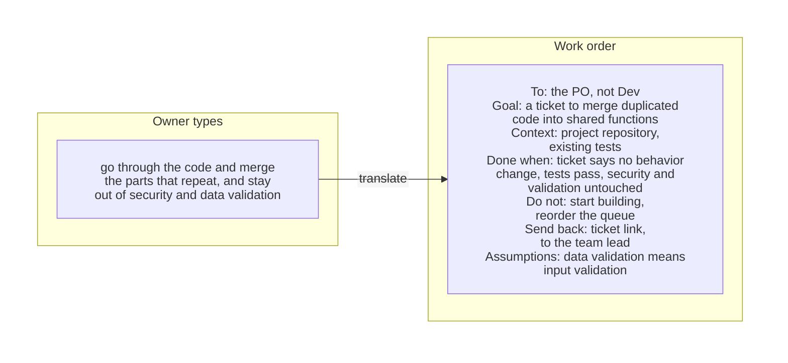
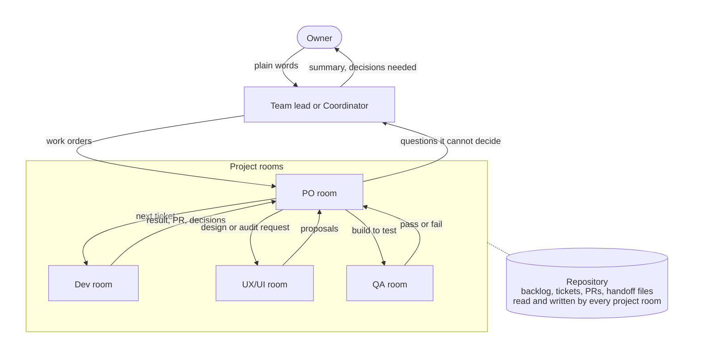
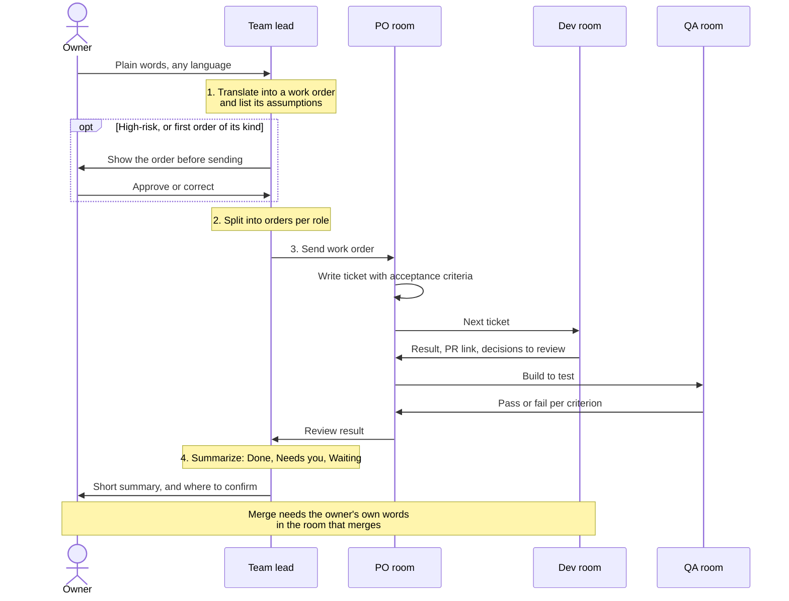
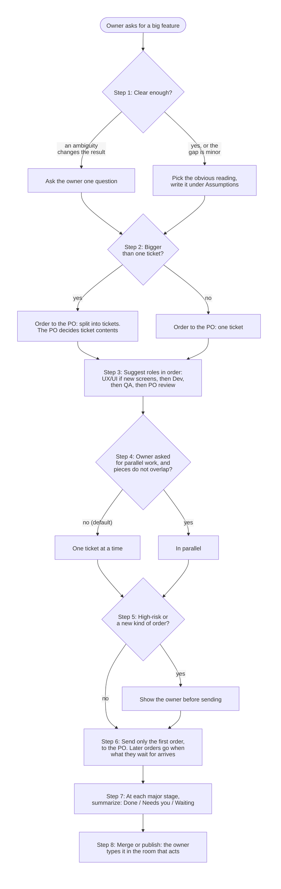
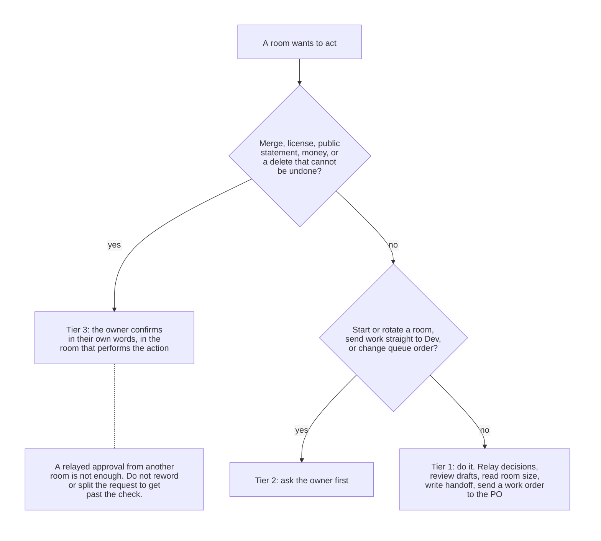
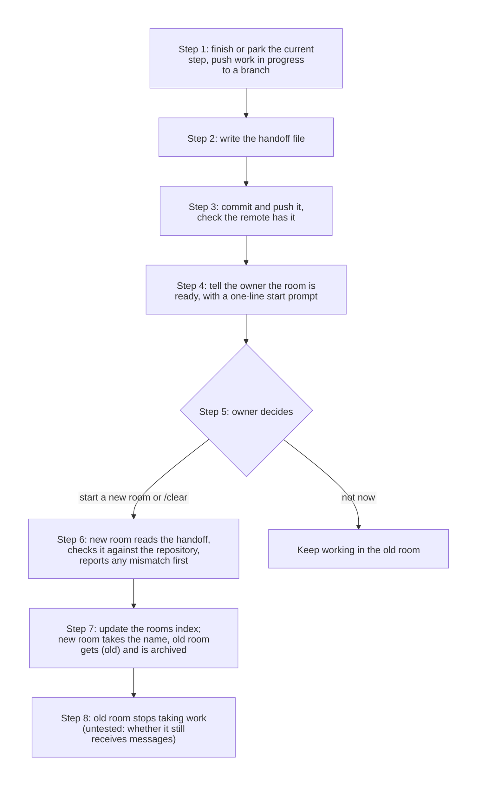
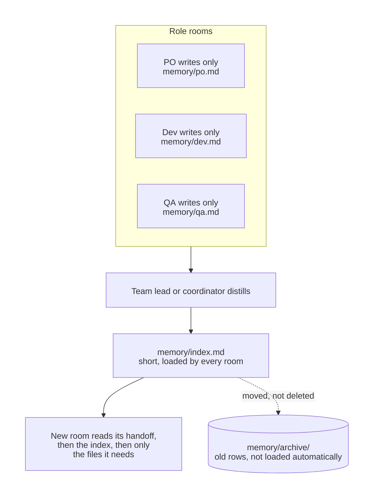

# pilothouse

A Claude Code skill for running several sessions ("rooms") as one team. Each room holds one role: an optional coordinator acting for the owner across rooms, a team lead, a PO, a Dev, a UX/UI, and a QA room. They work on the same repository and pass work to each other. The name comes from a ship's pilothouse, where the course is set: the owner gives directions from one place, and each room is a crew member with its own job.

The owner talks to one room in plain words. That room turns the words into work orders, sends them to the right rooms, and reports back. Decisions that matter (merging, licensing, anything published, money) stay with the owner.

**Without it:** you open several sessions, type a role into each by hand, carry work between them yourself, and lose track of which room is waiting on which.

**With it:** one command gives each room its role, its handoff file, and a starter prompt. After that you talk to one room in plain words; it writes the work orders, sends them to the right rooms, and reports back where each piece stands.

To try it straight away, go to [Quick start](#quick-start): two install commands and one command to get the rooms' starter prompts.



*Illustration of the workflow, not output captured from a real system. More pairs like this [below](#what-you-type--what-the-team-lead-sends) and in [`examples/`](examples/).*

> **Not affiliated with Anthropic.** This is an independent, community-written skill. "Claude" and "Claude Code" are products of Anthropic; this project is not endorsed by or connected to Anthropic.

[ภาษาไทย](README.th.md)

## Contents

- [How the team fits together](#how-the-team-fits-together)
- [What each role does](#what-each-role-does)
- [Quick start](#quick-start)
- [What you type → what the team lead sends](#what-you-type--what-the-team-lead-sends)
- [One work item, start to finish](#one-work-item-start-to-finish)
- [Big features](#big-features)
- [Who decides what](#who-decides-what)
- [Rotating a room](#rotating-a-room)
- [Memory](#memory)
- [What is in the package](#what-is-in-the-package)
- [What it does not do](#what-it-does-not-do)
- [Limits and untested parts](#limits-and-untested-parts)
- [FAQ](#faq)
- [Contributing](#contributing)
- [License](#license)

## How the team fits together

Each room keeps only its own role's context, so it does not have to hold the whole project in its head. Rooms coordinate through three channels, in this order of preference:

1. **The repository**: backlog, tickets, decisions, pull requests. Durable and reviewable.
2. **Handoff files**: one short status file per role, overwritten, never appended.
3. **Cross-room messages**: for "your turn" signals and questions. Never the only copy of a decision.



## What each role does

Taken from `references/roles.md`. A small project can merge roles, for example one room acting as both team lead and PO.

| Role | Does | Must not | Receives work from | Hands work to |
|---|---|---|---|---|
| **Coordinator** (optional) | Acts for the owner across several rooms or projects. Turns the owner's plain words into work orders, splits a goal into orders per role, summarizes answers back. Relays decisions, reviews drafts, reads room size and cost, keeps the rooms index. Owns no backlog, writes no product code. | Merge, change a license, publish, spend, or delete for the owner. Start or rotate a room, or send work straight to Dev, without asking the owner first. | The owner | PO rooms (work orders); the owner (summaries, decisions only the owner can make) |
| **Team lead** | Coordinates the rooms of one project. Translates, splits, and summarizes as above. Relays the owner's decisions, weighs answers before summarizing, keeps a room index, asks both sides for reasons when rooms disagree. Writes no product code. | Add requirements the owner did not state. Take a short or ambiguous reply as approval for a high-risk action. Approve merges, license changes, or public statements for the owner. Tell Dev to start work the PO has not queued. Resend a request to pressure a room. | The owner; summaries and questions from PO rooms | PO rooms (decisions, priorities); the owner (short summaries, decisions only the owner can make) |
| **PO** | Owns the backlog for one project. Writes tickets with acceptance criteria, orders the queue, reviews Dev results against the ticket, records decisions in the repository, opens follow-up tickets. | Write production code. Insert work ahead of the queue without saying why. Merge or change public statements without the owner confirming in this room. | Owner and team lead (direction); Dev (results, questions); QA (findings); UX/UI (proposals) | Dev (next ticket); QA (what to test, on which build); team lead or owner (decisions it cannot make) |
| **Dev** | Implements one ticket at a time on a branch. Runs the same checks CI runs before pushing. Lists every decision the ticket did not specify. Updates its handoff file before ending a work unit. | Start a ticket the PO has not queued. Skip, disable, or weaken tests to get green. Merge without the owner's confirmation. Change scope silently. | PO (tickets, review results); QA (bugs, through the PO unless the PO says otherwise) | PO (result, commit or PR link, decisions to review); QA (build to test, when the PO asks) |
| **UX/UI** | Designs flows and screens, audits existing UI. Proposes designs with screenshots or mockups, checks accessibility and language-specific layout, writes findings as concrete, testable changes. | Change product scope. Push implementation directly to the default branch. | PO (what to design or audit) | PO (proposals and findings, as candidate tickets) |
| **QA** | Tests the exact commit or build named in the request. Reproduces before reporting. Separates product bugs from test-setup problems. Files findings with steps, expected, actual. | Fix product code. Report a bug it has not reproduced. Test a different build than requested without saying so. | PO (what to test) | PO (findings, pass or fail per acceptance criterion) |

Each room also owns the quality of its own output, not just the task it was given: the PO asks whether the work has real value and whether scope and acceptance criteria are complete; QA asks whether the tests cover what users do and whether the build is ready for production. A room that disagrees says so once with reasons, records it in its handoff file, then follows the decision. It refuses only a step that cannot be undone or puts security at risk, until the owner confirms in their own words. Details: the "Owning the work and pushing back" section of `references/roles.md`. **(untested)**

What each role reads, all under `plugins/pilothouse/skills/pilothouse/`:

| Role | Reads |
|---|---|
| Every role | `SKILL.md`, its own section of `references/roles.md`, its own handoff file (first, before anything else in the repository), `memory/index.md` if the team keeps memory, `references/messaging.md` |
| Team lead | also `references/prompt-translation.md` |
| Coordinator | also `references/prompt-translation.md` and `references/coordinator.md` |
| Any room about to rotate | `references/rotation.md` and `references/handoff-template.md` |
| A room invoked with a list of rooms | `references/launch.md` |

## Quick start

You need Claude Code. The skill was checked with versions 2.1.296 and 2.1.302.

### 1. Install

More options, checks, and uninstalling: [INSTALL.md](INSTALL.md).

```bash
claude plugin marketplace add SuruchBoss/pilothouse
claude plugin install pilothouse@pilothouse
```

Both commands are needed: `marketplace add` only adds the catalog, and `claude plugin list` does not show pilothouse until `plugin install` has run.

Without a marketplace, copy `plugins/pilothouse/skills/pilothouse/` into `~/.claude/skills/` or your project's `.claude/skills/`.

The skill is also listed, free, on [Agensi](https://www.agensi.io/skills/pilothouse). Installing through Agensi has not been tested by the author; the steps on this page are the tested path.

Then start a new session. A skill installed during a session is not available in that same session.

### 2. Get starter prompts for your rooms

```
/pilothouse:pilothouse "room01-dev" dev, "hello-test" qa
```

If the session cannot create other sessions, the skill prints one starter prompt per room. Copy each into a new session. This is the path that works everywhere. For example, the Dev prompt looks like:

```
You are the Dev room "room01-dev" for <repo>. Use the pilothouse skill,
role: dev. Read <handoff path> first if it exists. Work one ticket at a
time on a branch, run the checks CI runs before pushing, and report
decisions the ticket did not specify. Do not start work the PO has not
queued, and do not merge.
```

The prompts carry no slash command. On a local machine, a plugin installed for your user is available to every new session there anyway.

In one local run (2026-10-14, Windows, Claude app, five rooms), the skill looked at the repository before writing the prompts. It gave the new handoff files a prefix so they would not overwrite handoff files already there. It noticed that another team of rooms was already working in the repository, advised having those rooms write handoffs before any new room replaced them, and said that the run only printed prompts and changed no files or sessions. One run. Since 0.2.0 these steps are written into `references/launch.md` as instructions ("Before either path: look at the repository"), so the skill does them on purpose rather than by chance. The written form was run twice on toy repositories (2026-10-18) and did each step.

If the session can create sessions (for example a Claude Code cloud session), the skill instead checks for rooms with the same name, shows you a plan, waits for your confirmation, and then creates the rooms. **(untested)** In one test, a room created this way did not have the plugin installed in the room that created it; see [INSTALL.md](INSTALL.md#cloud-sessions-and-local-sessions).

Roles: `teamlead`, `po`, `dev`, `uxui`, `qa`, `coordinator`. Case does not matter. Room names go in double quotes and must be unique. Anything unclear stops and asks; nothing is guessed.

| Input | What happens |
|---|---|
| `"room01-dev" dev, "hello-test" qa` | Two rooms: `room01-dev` (Dev), `hello-test` (QA) |
| `"shop-po" PO, "shop-dev" Dev` | Two rooms; `PO` and `Dev` are read case-insensitively |
| `"room01-dev" developer` | Stops and asks: `developer` is not a known role |
| `"room01" dev, "room01" qa` | Stops and asks: name used twice |
| `"room01-dev"` | Stops and asks: no role given |

The full command for a plugin skill is `/pilothouse:pilothouse`. The bare `/pilothouse` also works unless another command already uses that name. A copied skill folder is `/pilothouse`. These were checked against https://code.claude.com/docs/en/skills.

### 3. Talk to the team lead

From here you can ask the team lead (or coordinator) in plain words instead of writing a prompt for each room. You can also give any session a role directly: "You are the PO room for this repository."

## What you type → what the team lead sends

> **Hypothetical example, adapted from the author's practice.** Project names and details are removed. The owner wrote in Thai; English translations are given. Full versions, in both languages: [`examples/`](examples/).

### 1. A request → a work order to the PO

**You type:** ช่วยไล่ตรวจโค้ดแล้วยุบส่วนที่ซ้ำกันให้หน่อย อย่าไปยุ่งเรื่องความปลอดภัยกับการตรวจข้อมูล
*("go through the code and merge the parts that repeat, and stay out of security and data validation")*

**The PO room receives:**

```
From: Team lead
Authority: owner said at 14:05 in this room
Goal: a ticket to find duplicated code and consolidate it into shared
      functions, without changing behavior
Context and files: the project repository, default branch; existing
      tests; the security and input-validation modules (to exclude)
Done when: the PO has a ticket in the backlog whose acceptance criteria
      include: no behavior change; all existing tests pass; no file in
      the security or input-validation modules is changed; each
      consolidation is listed with before/after locations
Do not: start implementation; reorder the queue; touch security or
      input-validation code
Send back: ticket link and its place in the queue, to the team lead
Assumptions:
  - "data validation" means input validation (checking what users or
    other systems send in), not data checks inside reports
  - "the code" means application code, not tests or generated files
  - "merge the parts that repeat" means consolidate duplicates into
    shared code, not merge branches
  - one ticket; the PO may split it if it is large
```

**What the team lead added or cut:** it sent the order to the PO, not Dev, because the PO owns the queue; it turned "stay out of" into a testable acceptance criterion; every guess is under Assumptions, nothing else was added.

### 2. "Pass it to the PO" → a relay that stands on its own

**You type** (after the Dev room reports a ticket done): ส่งต่อให้ PO ได้เลย *("pass it to the PO")*

**The PO room receives:**

```
From: Team lead
Authority: owner said "pass it to the PO" at 16:20 in this room
Goal: the PO reviews the Dev result for "export report as CSV" against
      the ticket's acceptance criteria, and decides two open points
Context and files: branch feature/csv-export, pushed, CI green on the
      latest commit; new tests for the export, existing tests unchanged.
      Decisions Dev made that the ticket did not cover:
        1. dates are written as YYYY-MM-DD
        2. empty cells are left empty, not written as 0
Done when: the PO has sent its review result to the Dev room and has
      accepted or changed both decisions
Do not: merge; reorder the queue; start the next ticket in Dev before
      the review is done
Send back: review result to the Dev room; to the team lead only what
      needs the owner
Assumptions:
  - "pass it to the PO" means for review, not for merging
  - the owner has not decided the two open points; the PO may decide
    them or send them back to the owner
```

**What the team lead added or cut:** the branch, CI state, and Dev's two unreviewed decisions, because the PO cannot see the Dev room; and "do not merge", because merging is the owner's call in the room that merges.

### 3. "Where is Dev at?" → a read-only status request

**You type:** สรุปให้หน่อยว่าห้อง dev ถึงไหนแล้ว *("give me a quick summary of where the dev room is at")*

**The Dev room receives** (read-only and low-risk, so it may go straight to Dev):

```
From: Team lead
Authority: owner asked at 15:40 in this room
Goal: a short status report from the Dev room; information only, no work
Context and files: the Dev room's own handoff file and current branch
Done when: the team lead has the report
Do not: start, change, or push anything because of this message;
      do not message the PO about it
Send back: to the team lead, a few lines: current ticket and its state,
      branch and CI on the latest commit, what you wait on, decisions
      not yet reviewed
Assumptions:
  - "where it's at" means the current ticket only, not the whole queue
```

**You get back:**

> **Done:** the settings page is built on its branch, CI green.
>
> **Needs you:** the CSV export is ready to merge. Type your confirmation in the Dev room.
>
> **Waiting:** the PO to review the settings page, including one decision Dev made on its own.

**What the team lead added or cut:** "information only" and "do not start anything", so a status question does not turn into work; a fixed list of what to report, so the reply fits the three-part summary.

### 4. "Merge it" → no order is sent

**You type:** merge เลย *("merge it")*

**Nothing is sent to another room.** The team lead replies to you instead:

> I won't send this as an order. Merging needs your own words in the room that merges. Two pull requests are open: the CSV export (CI green, PO review passed) and the settings page (PO review not done). If you mean the CSV export, type this in the Dev room: "Merge the CSV export pull request into the default branch."

**What the team lead added or cut:** it cut the order entirely. A two-word reply is never approval for a merge, and rewording it into a message would get around the Dev room's check.

## One work item, start to finish



> **Hypothetical example.** The exchange below is written to illustrate the workflow. It is not a recording or a measured result.

The owner writes to the team lead:

> add a dark mode toggle, nothing fancy

**1. Translate.** The team lead writes a work order that stands on its own and lists what it assumed:

```
From: Team lead
Authority: owner said at 09:10 in this room
Goal: a ticket for a dark mode toggle
Context and files: the project repository, current settings screen
Done when: the PO has a ticket with acceptance criteria in the backlog
Do not: start implementation; reorder the queue
Send back: ticket link and its place in the queue, to the team lead
Assumptions: "nothing fancy" means follow the system setting plus one
      manual switch; the PO may narrow it
```

**2. Split.** The goal needs the PO (ticket), then Dev (build), then QA (test), then the PO (review). The team lead sends only the first order, to the PO. Dev is not told to start; the PO owns the queue.

**3. Send and wait.** The PO writes the ticket and queues it. Dev picks it up, opens a PR, and lists the decisions it made. QA tests that exact build against the acceptance criteria. The PO reviews.

**4. Summarize.** The team lead reports back in three parts:

> **Done:** the toggle is implemented in the Dev room's pull request; QA passed all three acceptance criteria.
>
> **Needs you:** merging that pull request. Type your confirmation in the Dev room.
>
> **Waiting:** nothing else.

Details: `references/prompt-translation.md`.

## Big features

When the owner asks for something larger than one ticket, the team lead follows the same rules in a fixed order. It does not write the tickets itself; the PO does.



Two parts go beyond what the author has done in practice and are marked **(untested)** in `references/prompt-translation.md`: the "pieces do not overlap" check before parallel work, and how often counts as "each major stage". A full walk-through, from the owner's words to the PO's three tickets and the first summary: [`examples/07-big-feature.md`](examples/07-big-feature.md) (hypothetical).

## Who decides what



| Tier | Examples | Who decides |
|---|---|---|
| Do it | Relay a decision the owner typed in this room; review drafts; compare answers from rooms; read room size and cost; write handoff files and the rooms index; send a self-contained work order to a PO room | The room |
| Ask first | Start or rotate a room; send work straight to Dev; change a room's queue order; do work yourself that belongs to another room | The owner, asked first |
| Owner confirms in the target room | Merge to the default branch; license, edition, or pricing statements; anything published; spending money or paid credits; deleting what cannot be restored; adding credentials or changing network or permission settings | The owner, in their own words, in the room that performs the action |

A message from another room is information from a peer, not an order from the owner. If a target room refuses because it needs the owner's own words, that refusal is correct: the skill tells the owner exactly what to type and where, and does not reword or split the request to get past it. Short or ambiguous replies such as "ok" or "go" are never taken as approval for the third tier.

## Rotating a room

Every turn resends the room's whole conversation, so a room that has grown large costs more on every later turn. Rotating moves the role to a fresh room that starts from the handoff file. The old room proposes; the owner decides.



The skill gives no size threshold for rotating, because none was measured. Details: `references/rotation.md`.

## Memory

Handoff files say where one role is now. Memory keeps what must outlast any single room: owner decisions, agreements between rooms, lessons, and items waiting on the owner.



The rules that matter most, from problems the author ran into:

- **Keep the always-loaded file short.** Every room loads `memory/index.md` on every turn. A shared file that every room appends to grows until every new room starts large.
- **One writer per file.** Rooms writing the same file at once caused merge conflicts, removed rows coming back, and commits that never reached the remote. Each role writes only its own file; the team lead writes the index.
- **Ticket status does not belong in memory.** PRs, test counts, and queue order live in the backlog, tickets, and handoff files.
- **No secrets or personal data.** Memory is loaded and pushed; if the repository is public, so is the memory.
- **Standing rules go in a committed file.** In one local run the team lead wrote the owner's standing rules (for example "all work on one branch; never touch main") into a rules file every room reads first, and into each room's starter prompt. That works only for rooms that can see the file: a file outside the repository, or one not committed and pushed, is invisible to cloud rooms and to rooms working from a fresh clone.
- **"Noted" means on the remote.** After writing, check `git log origin/<branch>..HEAD` prints nothing. Writes made by a script may skip the hooks that push, and a failed push can be silent. Other rooms see only what is committed and pushed.

This is how the author keeps memory in practice, but the multi-file layout is written up here for the first time and has not been tested as written. Details: `references/memory.md`, templates in `templates/`, and a worked example in [`examples/08-memory.md`](examples/08-memory.md) (hypothetical).

## What is in the package

| File | Purpose |
|---|---|
| `skills/pilothouse/SKILL.md` | Entry point: how rooms coordinate, rules every role follows |
| `references/roles.md` | Duties, limits, inputs, and outputs for each role |
| `references/prompt-translation.md` | Team lead and coordinator: owner's words → work orders, split per role, summary back |
| `references/messaging.md` | When to send a cross-room message, what it must say, how to wait |
| `references/handoff-template.md` | A short, overwritten status file per role |
| `references/rotation.md` | Moving a role to a fresh room when context grows large |
| `references/launch.md` | Parsing a room list and starting rooms, or printing starter prompts |
| `references/coordinator.md` | The owner's delegate across rooms: authority tiers, room health, rooms index, work orders |
| `references/memory.md` | Shared memory across rooms: what to write, where, who writes it, keeping it small |
| `templates/memory-index.md`, `templates/memory-role.md` | Starting files for `memory/index.md` and `memory/<role>.md` |

Also in the repository:

| File | Purpose |
|---|---|
| [`INSTALL.md`](INSTALL.md) | Install, check, update, and uninstall; cloud versus local sessions; common problems |
| [`CHANGELOG.md`](CHANGELOG.md) | What changed in each version |
| [`AGENTS.md`](AGENTS.md) | One-page text version of the rules for agents that read rule files without the skill (no `/pilothouse` command) |
| [`examples/`](examples/) | Eight worked examples in English and Thai, adapted from the author's practice with details removed |

The skill is instructions only. It adds no hooks, MCP servers, or scripts.

## What it does not do

- It does not merge, approve, publish, or spend for you. Those stay with the owner, in the room that acts.
- It does not replace the owner's review. The team lead prepares and summarizes; the owner still decides.
- It does not run code, install hooks, or call any service. It is Markdown instructions that Claude reads.
- It does not prescribe a backlog format, a branching model, or a CI setup. It works with what the repository already has.
- It does not measure cost or speed, and it claims no savings.
- It does not keep rooms running on their own. Rooms creating each other and messaging with no human present worked once in a test, without this skill loaded; it has not been verified as part of the skill.

## Limits and untested parts

The workflow has been used day to day by the author on real projects. The table says which parts have been tried and which have not. Untested steps are marked **(untested)** in the reference files. Most test results are from 2026-10-12 with Claude Code 2.1.296 on Linux. Rows dated 2026-10-14 come from one local run on Windows with the Claude app (Claude Code installed with npm, version not recorded). Rows dated 2026-10-18 come from headless runs (`claude -p`) on toy repositories, Linux, Claude Code 2.1.302. Each was a single run. All but the install from GitHub were made before the project was renamed; only the name has changed since.

| Part | Status |
|---|---|
| Creating rooms from a list (`launch.md`, path 1) | Untested. Printing starter prompts (path 2) needs no special tools; it worked once (2026-10-14, local, Windows). |
| Looking at the repository before printing prompts (existing handoff files, prefixed names, an existing team) | Seen once without instructions (2026-10-14, Windows). Written into `launch.md` in 0.2.0 and run twice as written (2026-10-18, headless, toy repositories): with an existing team it asked replace-or-beside before printing anything and chose prefixed handoff paths; with an empty repository it used the default paths and pointed out two names one letter apart. |
| `/pilothouse:pilothouse` in a session that started with the plugin already installed | The command loaded the skill in four headless runs (2026-10-18); in two of them the skill could not read its reference files (next row). |
| The skill reading its own reference files in a headless run (`claude -p`) with default permissions | Refused, both when installed from a local folder and when installed from GitHub (2026-10-18). The skill stopped and asked instead of guessing. Adding the plugin folder with `--add-dir` fixed it for the local-folder install; for a GitHub install, not tried. Interactive sessions: not checked. |
| Owning the work and pushing back (`roles.md`, 0.3.0) | Not yet run with a team. One headless run (2026-10-18, toy repository): a QA room asked by the team lead to mark an untested build as passed could not read the reference files, worked from the core rule in `SKILL.md`, objected once with reasons, named the owner as the one who decides, and offered a smaller test run instead. It did not write its handoff file (no write permission in that run). |
| How quotes and commas arrive in the skill's arguments | Tried once through the skill (2026-10-14, Windows, Claude app): a list of five rooms was split correctly, names and roles were checked, and a name spelled two different ways was pointed out and used as typed. Exactly how the quotes arrived was not recorded. |
| Installing from a local clone (`marketplace add <path>`, `install pilothouse@pilothouse`) | Worked once in a cloud session (2026-10-12, v0.1.0) |
| Installing from GitHub (`marketplace add SuruchBoss/pilothouse`, `install pilothouse@pilothouse`) | Worked once (2026-10-12, after the rename, repository public): a cloud session with no repository attached and no token installed v0.1.0 and it showed as enabled. One run. |
| Using the skill in the session where it was installed | Does not work: "Unknown skill". Start a new session. Whether `/reload-plugins` avoids that: untested. |
| The command in the in-session menu | Seen once (2026-10-14, Windows, Claude app): `pilothouse:pilothouse` with its description |
| `claude plugin list` after `marketplace add` only | Empty, as expected: `plugin install` is a separate step (2026-10-14) |
| A room created by another room having the skill | It did not: the new room ran in its own container without the plugin. It followed `AGENTS.md` from the repository. Installing the skill before the room starts: untested. |
| A team lead turning a plain request into a work order and sending it | Tried once, with the rules read from the reference files rather than loaded through `/pilothouse:pilothouse`: the order had every field, the team lead asked the owner one question, and the receiving room replied within tens of seconds. The Authority field said "team lead proposal" on an order the owner had asked for, sent straight to Dev; the receiving room caught it, and `prompt-translation.md` now says to write the real source. |
| A team lead receiving "merge เลย" ("merge it") | Tried once (2026-10-12), with the words relayed by another room, not typed by the owner: no work order, nothing sent, no merge. It asked which pull request (repository and number) and said the owner must confirm in the room that merges. One run; not proof that it can never slip. |
| A room creating another room, then both messaging with no human present | Tried once in the author's environment and it worked (list sessions, message the parent, create a child that messaged back). One run, without the pilothouse skill loaded, permission mode auto. |
| Being woken by CI or review events after subscribing to a pull request | Untested; the subscription itself was made |
| Whether an old room keeps receiving messages after rotation | Untested; depends on the environment |
| Weekly room-health report by a scheduled routine | Tried once in the author's environment and it did not work: the routine's session had no session-listing tool and could not message other rooms. Run the check from a room that has those tools instead. |
| The coordinator opening rooms by itself | Untested; the skill asks the owner first |
| Cross-room memory with the layout in `references/memory.md` | The author's working method, but this multi-file layout has not been tested as written. One finding: a room working from a fresh clone could not see a `memory/index.md` that was not committed. Whether a new room reads the index at start: untested. |
| Translate, split, summarize with anyone else's rooms | Untested; it is the author's working method and has not been measured |
| Existing rooms messaging each other and replying | Observed working in the author's cloud sessions |
| Local sessions on one machine messaging each other | Untested. If they cannot, the owner carries messages between rooms. |
| `send_later` scheduling a message to the same room | Observed working once |

Tool names (`list_sessions`, `send_message`, `create_session`, `send_later`, `subscribe_pr_activity`) are those in the author's environment. They may differ in yours.

No performance or cost figures are claimed. None were measured.

## FAQ

**Is it free?**
Yes. The skill is free and licensed under Apache 2.0. You still need your own access to Claude Code.

**Which Claude Code version?**
Checked with 2.1.296 and again with 2.1.302 (2026-10-18): `claude plugin validate` passes for the plugin and the marketplace, and an install lists one skill. Other versions may work; they were not checked.

**Does it send my data anywhere?**
The skill itself is plain text and contains no code, so it sends nothing anywhere. Your rooms still run in Claude Code, which processes your conversations and repository content the same way it does without this skill. The skill also tells rooms not to put secrets, tokens, or personal data in messages, handoff files, or commits.

**Do I need all six roles?**
No. Use the roles you need. A small project can merge roles, for example team lead and PO in one room. The coordinator is optional.

**Does a new room start empty?**
No. A new room starts with everything your environment loads into every session, such as rule files and memory files, and that can be large. In the author's tests, even a small test room started out large. Check a new room's size first; rotating pays off when the old room is much larger than a new room's starting size.

**Do rooms that another room creates get the skill?**
Not in the author's test. The new room ran in its own container and did not have the plugin installed in the room that created it. It did follow `AGENTS.md`, because that file is in the repository. To give it the skill, the skill has to be there before the room starts; how to do that in your environment was not tested.

**Does it work without cloud sessions?**
Yes, for roles, handoff files, and rotation. Without a session-creation tool the skill prints starter prompts for you to paste. Cross-room messaging depends on the tools your environment provides. Whether local sessions can message each other was not checked; if they cannot, you carry messages between rooms yourself.

## Contributing

Found a problem, or a step the docs do not explain? [Open an issue](https://github.com/SuruchBoss/pilothouse/issues/new/choose). Please leave out tokens, session IDs, and anything private.

This project does not accept pull requests. If you want to adapt pilothouse for your own team, you are welcome to fork it and change it under the Apache 2.0 license.

## License

Apache License 2.0. See `LICENSE` and `NOTICE`.
