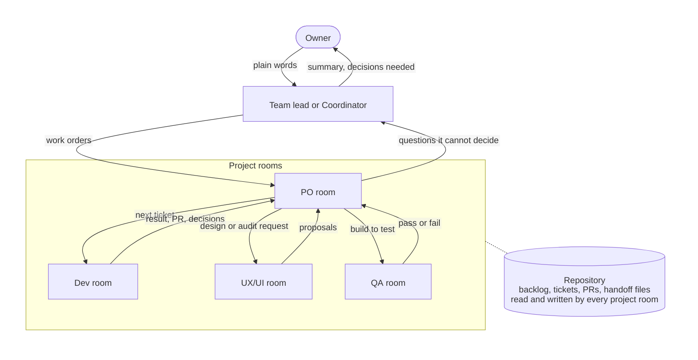

# pilothouse

**Stop being the messenger between your AI sessions.**

[ภาษาไทย](README.th.md)

It is late, and you have four Claude Code sessions open. You typed "clean up the duplicated code" into one of them, and it started straight away. Halfway through, it rewrote the validation code you meant to keep out of it. You explain again, it fixes it, and you pay for the work twice. The QA session is still testing yesterday's build, because nobody told it about the new one. Nobody, in this case, is you. You are not running a team. You are carrying its mail.

With pilothouse, you tell one room in plain words what you want. It writes a work order (the goal, what "done" means, what not to touch) and sends it to the room whose job it is. If your words could mean two things, it asks you one question first. The PO asks whether the work is worth doing. QA says "not ready" when it is not. A room that thinks you are making a mistake says so once, writes it down, and then does what you decide. Merges, licenses, anything public, and money still wait for your own words.

You stop carrying messages. You keep the decisions.

pilothouse is a free skill for **Claude Code** (Apache 2.0). A "room" is one Claude Code session; each room holds one role. It has been used day to day with one real team of rooms for about a month, by one person, with nothing measured. What has and has not been tried: [docs/TESTED.md](docs/TESTED.md).

## New in 0.4.0: three checks from real use

Each comes from a failure seen in the author's rooms. The rules as written are untested.

- **Plan before others build.** A room that hands out work does not tell other rooms to start until the owner has confirmed the plan in their own words.
- **"Ready" means someone outside tried it.** Work outsiders will see is not called ready until someone who has not seen the code has gone through the main path on a real device. Passing end-to-end tests are not enough.
- **Check the pull request at merge time.** Check the base branch and the reviewed head commit, and afterwards look for commits that arrived later.

All changes: [CHANGELOG.md](CHANGELOG.md).

## Quick start

```bash
claude plugin marketplace add SuruchBoss/pilothouse
claude plugin install pilothouse@pilothouse
```

Both commands are needed. Then start a **new** session; a skill installed during a session is not available in that session. Without a marketplace, copy `plugins/pilothouse/skills/pilothouse/` into `~/.claude/skills/` or your project's `.claude/skills/`. Also listed free on [Agensi](https://www.agensi.io/skills/pilothouse) (that install path is untested). More options and uninstalling: [INSTALL.md](INSTALL.md).

Ask for starter prompts, one per room:

```
/pilothouse:pilothouse "room01-dev" dev, "hello-test" qa
```

Paste each prompt into a new session. Roles: `teamlead`, `po`, `dev`, `uxui`, `qa`, `coordinator` (any case). Room names go in double quotes and must be unique; an unknown role, a repeated name, or a missing role stops and asks. The bare `/pilothouse` also works unless another command uses that name. Before printing anything, the skill looks at the repository, and if another team of rooms already works there, it asks whether to replace it or work beside it.

From then on, talk to the team lead in plain words.

## How the team fits together

Each room keeps only its own role's context. Rooms coordinate through three channels, in this order: the **repository** (tickets, decisions, pull requests), one short **handoff file** per role (overwritten, never appended), and **cross-room messages** for "your turn" and questions, never the only copy of a decision.



| Role | Does | Must not |
|---|---|---|
| **Coordinator** (optional) | Acts for the owner across rooms or projects: translates, splits, summarizes, keeps the rooms index | Merge, license, publish, spend, or delete for the owner |
| **Team lead** | Coordinates one project's rooms: turns the owner's words into work orders, relays decisions, summarizes back | Add requirements; send work to Dev that the PO has not queued |
| **PO** | Owns the backlog; writes tickets with acceptance criteria; reviews Dev results | Write production code; merge |
| **Dev** | One ticket at a time on a branch; runs CI's checks before pushing; lists decisions the ticket did not cover | Start unqueued work; weaken tests; merge without the owner |
| **UX/UI** | Designs and audits UI; hands findings to the PO as candidate tickets | Change scope; push to the default branch |
| **QA** | Tests the exact build named; reproduces before reporting | Fix product code; report what it has not reproduced |

A small project can merge roles, for example team lead and PO in one room. Each room owns the quality of its own output, not just the task; if it disagrees, it says so once with reasons, records it, then follows the decision. Full duties: `references/roles.md`.

## What you type, what the team lead sends

> Hypothetical example, adapted from the author's practice. The owner wrote in Thai.

**You type:** "go through the code and merge the parts that repeat, and stay out of security and data validation"

**The PO room receives:**

```
From: Team lead
Authority: owner said at 14:05 in this room
Goal: a ticket to find duplicated code and consolidate it into shared
      functions, without changing behavior
Context and files: the project repository, default branch; existing
      tests; the security and input-validation modules (to exclude)
Done when: the PO has a ticket whose acceptance criteria include: no
      behavior change; all existing tests pass; no file in the security
      or input-validation modules is changed
Do not: start implementation; reorder the queue
Send back: ticket link and its place in the queue, to the team lead
Assumptions:
  - "data validation" means input validation
  - "merge the parts that repeat" means consolidate duplicates,
    not merge branches
```

It went to the PO, not Dev, because the PO owns the queue. "Stay out of" became a testable criterion, and every guess is listed under Assumptions.

If you type "merge it", **nothing is sent**. The team lead tells you which pull requests are open and what to type, in your own words, in the room that merges. More pairs (relaying to the PO, a status check, a summary, a big feature, memory) in [`examples/`](examples/), in English and Thai.

## Who decides what

| Tier | Examples | Who decides |
|---|---|---|
| Do it | Relay the owner's decision, review drafts, write handoff files, send a work order to the PO | The room |
| Ask first | Start or rotate a room, send work straight to Dev, change queue order | The owner |
| Owner confirms in the target room | Merge, license or public statements, spending, irreversible deletes, credentials or permission changes | The owner, in their own words, in the room that acts |

A message from another room is information from a peer, not an order. "ok" or "go" is never approval for the third tier, and a room does not reword a request to get past the check.

## Rotating rooms and memory

Every turn resends a room's whole conversation, so a large room costs more on every turn. **Rotating** moves the role to a fresh room that starts from the handoff file; the old room proposes, the owner decides. No size threshold is given, because none was measured, and a new room is not empty: it loads whatever your environment loads into every session. Details: `references/rotation.md`.

**Memory** keeps what must outlast a room: owner decisions, agreements, lessons. Each role writes only its own `memory/<role>.md`; the team lead keeps a short `memory/index.md` that every room reads. Standing rules go in a committed file every room reads. No ticket status, secrets, or personal data in memory, and "noted" means pushed to the remote. Details: `references/memory.md`.

## What is in the package

Markdown instructions only: no hooks, MCP servers, or scripts. The skill itself runs no code and sends nothing anywhere; your rooms still run in Claude Code as usual. The entry point is `SKILL.md`; each role reads its section of `references/roles.md` and its own handoff file first. [`AGENTS.md`](AGENTS.md) is a one-page version for agents that read rule files without the skill (untested with any of them).

It does not merge, publish, or spend for you, does not replace your review, does not prescribe a backlog or CI setup, and claims no savings in time or cost.

## FAQ

**Does it work with Cursor, Codex, or other tools?** Not tried. It was written for and tried only with Claude Code.

**Which Claude Code version?** Checked with 2.1.296 and 2.1.302.

**Do I need all six roles?** No. Use the ones you need; the coordinator is optional.

**Does it work without cloud sessions?** Yes, for roles, handoff files, and rotation. Without a session-creation tool you paste the starter prompts yourself. Whether local sessions can message each other was not checked; if not, you carry messages yourself.

**Do rooms created by another room get the skill?** Not in the author's test. They followed `AGENTS.md` from the repository instead. See [docs/TESTED.md](docs/TESTED.md).

## Contributing

Found a problem? [Open an issue](https://github.com/SuruchBoss/pilothouse/issues/new/choose), and leave out tokens, session IDs, and anything private. This project does not accept pull requests; you are welcome to fork it under Apache 2.0.

> **Not affiliated with Anthropic.** "Claude" and "Claude Code" are products of Anthropic; this independent skill is not endorsed by or connected to Anthropic.

## License

Apache License 2.0. See `LICENSE` and `NOTICE`.
