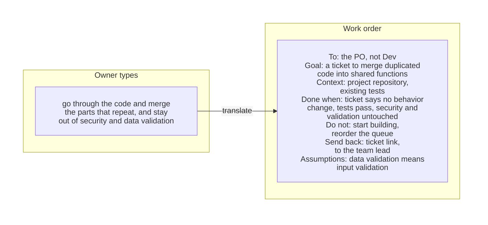
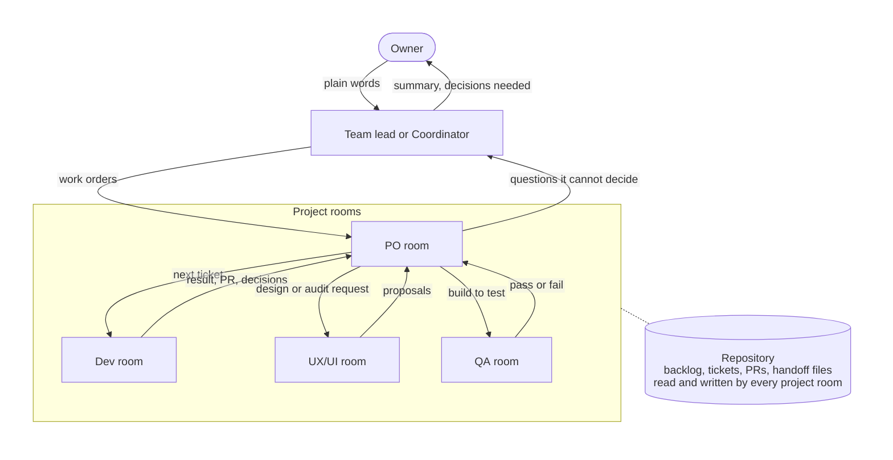
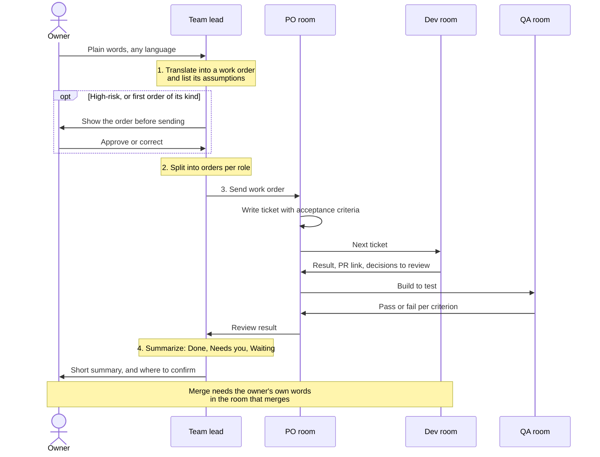
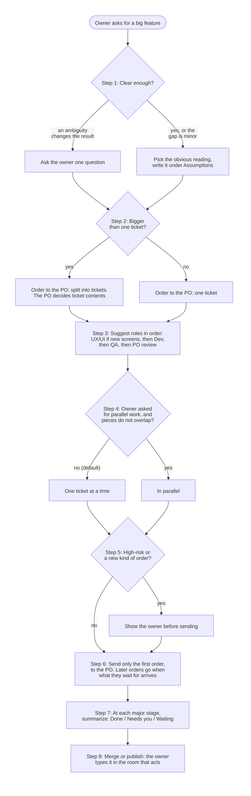
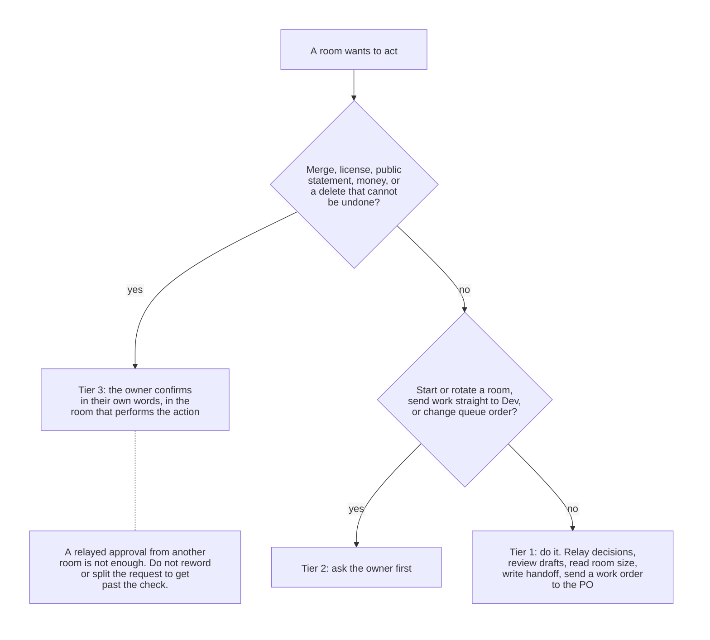
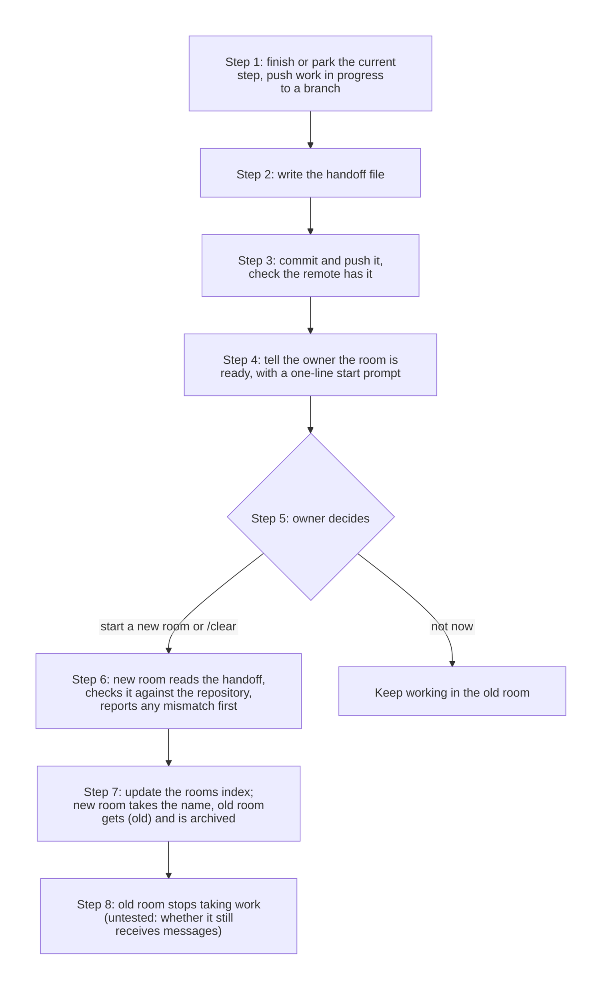
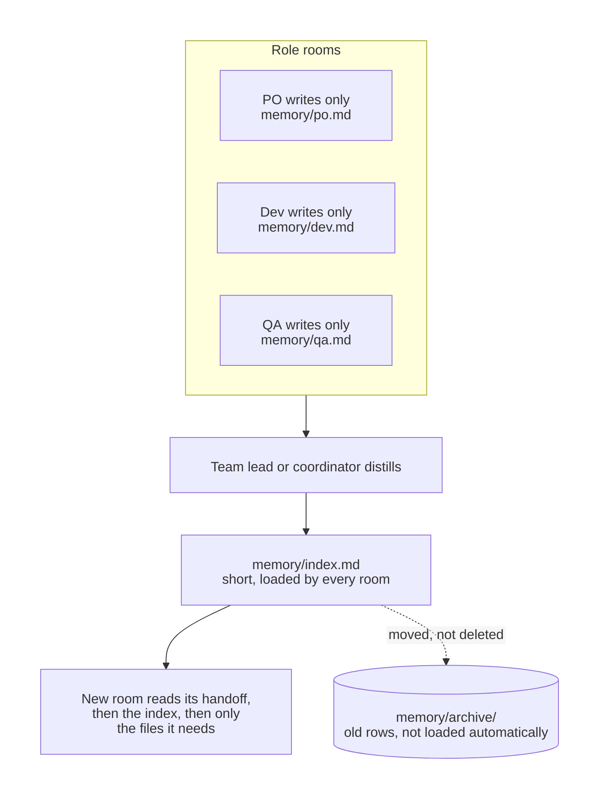

# pilothouse

Skill สำหรับ Claude Code ที่ใช้รัน session หลายตัว (เรียกว่า "ห้อง") ให้ทำงานเป็นทีมเดียว แต่ละห้องรับหนึ่งบทบาท ได้แก่ coordinator (ตัวแทนเจ้าของข้ามหลายห้อง ใช้หรือไม่ใช้ก็ได้), team lead, PO, Dev, UX/UI และ QA ทุกห้องทำงานบน repository เดียวกันและส่งต่องานให้กัน ชื่อมาจาก pilothouse ห้องบังคับเรือที่ใช้กำหนดทิศทาง เจ้าของสั่งการจากที่เดียว ส่วนแต่ละห้องเป็นลูกเรือที่มีหน้าที่ของตัวเอง

เจ้าของคุยกับห้องเดียวด้วยภาษาพูดธรรมดา ห้องนั้นจะแปลงเป็นใบสั่งงาน ส่งไปยังห้องที่ถูกต้อง แล้วสรุปกลับมา ส่วนเรื่องสำคัญ (merge ไลเซนส์ สิ่งที่เผยแพร่สาธารณะ และเงิน) ยังเป็นการตัดสินของเจ้าของเสมอ

**ก่อนใช้:** เปิดหลาย session พิมพ์บทบาทให้ทีละห้องเอง ส่งต่องานระหว่างห้องเอง และไม่รู้ว่าห้องไหนรอห้องไหนอยู่

**หลังใช้:** คำสั่งเดียวได้บทบาท ไฟล์ handoff และ prompt เริ่มต้นของทุกห้อง จากนั้นคุยกับห้องเดียวด้วยภาษาพูด ห้องนั้นเขียนใบสั่งงาน ส่งไปห้องที่ถูกต้อง แล้วสรุปกลับมาว่างานแต่ละชิ้นอยู่ตรงไหน



*ภาพประกอบขั้นตอน ไม่ใช่ผลลัพธ์ที่จับมาจากระบบจริง มีคู่แบบนี้เพิ่มอีก[ข้างล่าง](#พิมพ์อะไร--team-lead-ส่งอะไร) และใน [`examples/`](examples/)*

> **ไม่เกี่ยวข้องกับ Anthropic** โปรเจกต์นี้เขียนขึ้นโดยอิสระ "Claude" และ "Claude Code" เป็นผลิตภัณฑ์ของ Anthropic โปรเจกต์นี้ไม่ได้รับการรับรองหรือมีส่วนเกี่ยวข้องกับ Anthropic

[English](README.md)

## สารบัญ

- [ทีมเชื่อมกันอย่างไร](#ทีมเชื่อมกันอย่างไร)
- [แต่ละบทบาททำอะไร](#แต่ละบทบาททำอะไร)
- [เริ่มต้นใช้งาน](#เริ่มต้นใช้งาน)
- [พิมพ์อะไร → team lead ส่งอะไร](#พิมพ์อะไร--team-lead-ส่งอะไร)
- [หนึ่งใบงาน ตั้งแต่ต้นจนจบ](#หนึ่งใบงาน-ตั้งแต่ต้นจนจบ)
- [ฟีเจอร์ใหญ่](#ฟีเจอร์ใหญ่)
- [ใครตัดสินเรื่องไหน](#ใครตัดสินเรื่องไหน)
- [การหมุนห้อง](#การหมุนห้อง)
- [ความจำ](#ความจำ)
- [ในแพ็กเกจมีอะไรบ้าง](#ในแพ็กเกจมีอะไรบ้าง)
- [สิ่งที่ skill นี้ไม่ทำ](#สิ่งที่-skill-นี้ไม่ทำ)
- [ข้อจำกัดและส่วนที่ยังไม่ได้ทดสอบ](#ข้อจำกัดและส่วนที่ยังไม่ได้ทดสอบ)
- [คำถามที่พบบ่อย](#คำถามที่พบบ่อย)
- [การมีส่วนร่วม](#การมีส่วนร่วม)
- [ไลเซนส์](#ไลเซนส์)

## ทีมเชื่อมกันอย่างไร

แต่ละห้องเก็บ context เฉพาะบทบาทของตัวเอง ไม่ต้องแบกทั้งโปรเจกต์ไว้ในหัว ห้องต่างๆ ประสานงานกันผ่านสามช่องทาง เรียงจากที่ควรใช้ก่อน

1. **repository**: backlog, ใบงาน, บันทึกการตัดสินใจ, pull request อยู่ถาวรและตรวจย้อนได้
2. **ไฟล์ handoff**: ไฟล์สถานะสั้นๆ หนึ่งไฟล์ต่อบทบาท เขียนทับ ไม่ต่อท้าย
3. **ข้อความข้ามห้อง**: ใช้ส่งสัญญาณ "ถึงตาเธอแล้ว" และคำถาม ห้ามเป็นที่เดียวที่เก็บการตัดสินใจ



## แต่ละบทบาททำอะไร

นำมาจาก `references/roles.md` โปรเจกต์เล็กรวมบทบาทได้ เช่น ห้องเดียวเป็นทั้ง team lead และ PO

| บทบาท | ทำอะไร | ห้ามทำอะไร | รับงานจาก | ส่งงานต่อให้ |
|---|---|---|---|---|
| **Coordinator** (ไม่บังคับ) | ทำแทนเจ้าของข้ามหลายห้องหรือหลายโปรเจกต์ แปลคำพูดธรรมดาของเจ้าของเป็นใบสั่งงาน แตกเป้าหมายเป็นใบสั่งงานต่อบทบาท และสรุปคำตอบกลับ ส่งต่อการตัดสินใจ ตรวจร่าง ดูขนาดและค่าใช้จ่ายของห้อง ดูแลดัชนีห้อง ไม่ถือ backlog และไม่เขียนโค้ดของผลิตภัณฑ์ | merge เปลี่ยนไลเซนส์ เผยแพร่ ใช้เงิน หรือลบแทนเจ้าของ เปิดหรือหมุนห้อง หรือส่งงานตรงถึง Dev โดยไม่ถามเจ้าของก่อน | เจ้าของ | ห้อง PO (ใบสั่งงาน), เจ้าของ (สรุป และเรื่องที่เจ้าของต้องตัดสินเอง) |
| **Team lead** | ประสานห้องต่างๆ ในโปรเจกต์เดียว แปล แตกงาน และสรุปแบบเดียวกับข้างบน ส่งต่อการตัดสินใจของเจ้าของ ชั่งคำตอบก่อนสรุป ดูแลดัชนีห้อง เมื่อห้องเห็นไม่ตรงกันให้ถามเหตุผลทั้งสองฝั่ง ไม่เขียนโค้ดของผลิตภัณฑ์ | เพิ่มข้อกำหนดที่เจ้าของไม่ได้พูด ถือคำตอบสั้นหรือกำกวมเป็นการอนุมัติเรื่องเสี่ยงสูง อนุมัติ merge ไลเซนส์ หรือประกาศสาธารณะแทนเจ้าของ สั่ง Dev เริ่มงานที่ PO ยังไม่ได้เข้าคิว ส่งคำขอซ้ำเพื่อกดดันห้องอื่น | เจ้าของ, สรุปและคำถามจากห้อง PO | ห้อง PO (การตัดสินใจ ลำดับความสำคัญ), เจ้าของ (สรุปสั้น และเรื่องที่เจ้าของต้องตัดสินเอง) |
| **PO** | ถือ backlog ของโปรเจกต์ เขียนใบงานพร้อมเกณฑ์ยอมรับ จัดลำดับคิว ตรวจผลของ Dev เทียบกับใบงาน บันทึกการตัดสินใจใน repository เปิดใบงานต่อเนื่อง | เขียนโค้ดของผลิตภัณฑ์ แทรกคิวโดยไม่บอกเหตุผล merge หรือแก้ประกาศสาธารณะโดยเจ้าของไม่ได้ยืนยันในห้องนี้ | เจ้าของและ team lead (ทิศทาง), Dev (ผลงาน คำถาม), QA (สิ่งที่พบ), UX/UI (ข้อเสนอ) | Dev (ใบงานถัดไป), QA (ทดสอบอะไร บน build ไหน), team lead หรือเจ้าของ (เรื่องที่ตัดสินเองไม่ได้) |
| **Dev** | ทำทีละใบงานบน branch รันการตรวจชุดเดียวกับ CI ก่อน push ไล่ทุกการตัดสินใจที่ใบงานไม่ได้ระบุ อัปเดตไฟล์ handoff ก่อนจบงานแต่ละช่วง | เริ่มใบงานที่ PO ยังไม่ได้เข้าคิว ข้าม ปิด หรือลดเทสต์เพื่อให้ผ่าน merge โดยเจ้าของไม่ยืนยัน เปลี่ยนขอบเขตเงียบๆ | PO (ใบงาน ผลการตรวจ), QA (บั๊ก ผ่าน PO เว้นแต่ PO บอกเป็นอย่างอื่น) | PO (ผลงาน ลิงก์ commit หรือ PR การตัดสินใจที่ต้องตรวจ), QA (build ให้ทดสอบ เมื่อ PO ขอ) |
| **UX/UI** | ออกแบบ flow และหน้าจอ ตรวจ UI ที่มีอยู่ เสนอแบบพร้อมภาพหน้าจอหรือ mockup ตรวจการเข้าถึงและการจัดวางตามภาษา เขียนสิ่งที่พบเป็นการแก้ที่ชัดและทดสอบได้ | เปลี่ยนขอบเขตผลิตภัณฑ์ push โค้ดตรงเข้า default branch | PO (ออกแบบหรือตรวจอะไร) | PO (ข้อเสนอและสิ่งที่พบ ในรูปใบงานที่เสนอ) |
| **QA** | ทดสอบ commit หรือ build ที่ระบุในคำขอเท่านั้น ทำให้เกิดซ้ำก่อนรายงาน แยกบั๊กของผลิตภัณฑ์ออกจากปัญหาของชุดทดสอบ รายงานพร้อมขั้นตอน ผลที่คาด และผลจริง | แก้โค้ดของผลิตภัณฑ์ รายงานบั๊กที่ยังทำให้เกิดซ้ำไม่ได้ ทดสอบ build อื่นโดยไม่บอก | PO (ทดสอบอะไร) | PO (สิ่งที่พบ ผ่านหรือไม่ผ่านต่อเกณฑ์ยอมรับ) |

ไฟล์ที่แต่ละบทบาทต้องอ่าน อยู่ใต้ `plugins/pilothouse/skills/pilothouse/` ทั้งหมด

| บทบาท | อ่าน |
|---|---|
| ทุกบทบาท | `SKILL.md`, หัวข้อของบทบาทตัวเองใน `references/roles.md`, ไฟล์ handoff ของตัวเอง (อ่านก่อนอย่างอื่นใน repository), `memory/index.md` ถ้าทีมเก็บความจำ, `references/messaging.md` |
| Team lead | เพิ่ม `references/prompt-translation.md` |
| Coordinator | เพิ่ม `references/prompt-translation.md` และ `references/coordinator.md` |
| ห้องที่กำลังจะหมุน | `references/rotation.md` และ `references/handoff-template.md` |
| ห้องที่ถูกเรียกพร้อมรายการห้อง | `references/launch.md` |

## เริ่มต้นใช้งาน

ต้องมี Claude Code ตรวจกับเวอร์ชัน 2.1.296

### 1. ติดตั้ง

ทางเลือกอื่น วิธีเช็ก และการถอน อยู่ใน [INSTALL.th.md](INSTALL.th.md)

```bash
claude plugin marketplace add SuruchBoss/pilothouse
claude plugin install pilothouse@pilothouse
```

ต้องรันทั้งสองคำสั่ง `marketplace add` แค่เพิ่มแคตตาล็อก และ `claude plugin list` จะยังไม่เห็น pilothouse จนกว่าจะรัน `plugin install`

ถ้าไม่ใช้ marketplace ให้คัดลอก `plugins/pilothouse/skills/pilothouse/` ไปไว้ใน `~/.claude/skills/` หรือ `.claude/skills/` ของโปรเจกต์

skill นี้ลงรายการฟรีบน [Agensi](https://www.agensi.io/skills/pilothouse) ด้วย การติดตั้งผ่าน Agensi ผู้เขียนยังไม่ได้ทดสอบ วิธีในหน้านี้คือทางที่ทดสอบแล้ว

จากนั้นเปิด session ใหม่ skill ที่ติดตั้งระหว่าง session ใช้ใน session เดิมไม่ได้

### 2. ขอ prompt เริ่มต้นของแต่ละห้อง

```
/pilothouse:pilothouse "room01-dev" dev, "hello-test" qa
```

ถ้า session สร้าง session อื่นไม่ได้ skill จะพิมพ์ prompt เริ่มต้นให้ห้องละหนึ่งอัน คัดลอกไปวางใน session ใหม่ทีละห้อง วิธีนี้ใช้ได้ทุกที่ ตัวอย่าง prompt ของ Dev

```
You are the Dev room "room01-dev" for <repo>. Use the pilothouse skill,
role: dev. Read <handoff path> first if it exists. Work one ticket at a
time on a branch, run the checks CI runs before pushing, and report
decisions the ticket did not specify. Do not start work the PO has not
queued, and do not merge.
```

prompt ที่พิมพ์ให้ไม่มีคำสั่ง slash บนเครื่องตัวเอง plugin ที่ติดตั้งระดับผู้ใช้ใช้ได้ในทุก session ใหม่บนเครื่องนั้นอยู่แล้ว

ในการรันในเครื่องครั้งหนึ่ง (14 ต.ค. 2026, Windows, แอป Claude, ห้าห้อง) skill ดู repository ก่อนเขียน prompt ตั้งชื่อไฟล์ handoff ใหม่ให้มีคำนำหน้าเพื่อไม่ทับไฟล์ handoff ที่มีอยู่แล้ว สังเกตเห็นว่ามีทีมห้องอีกชุดทำงานใน repository อยู่ แนะนำให้ห้องเหล่านั้นเขียน handoff ก่อนถ้าจะให้ห้องใหม่มาแทน และบอกว่ารอบนั้นแค่พิมพ์ prompt ไม่ได้แก้ไฟล์หรือ session ใด รันครั้งเดียว

ถ้า session สร้าง session ได้ (เช่น session บนคลาวด์ของ Claude Code) skill จะเช็กก่อนว่ามีห้องชื่อซ้ำไหม แสดงแผน รอเจ้าของยืนยัน แล้วค่อยสร้างห้อง **(ยังไม่ได้ทดสอบ)** ในการทดสอบครั้งหนึ่ง ห้องที่สร้างแบบนี้ไม่มี plugin ที่ติดตั้งในห้องที่สร้างมัน ดู [INSTALL.th.md](INSTALL.th.md#session-บนคลาวด์-กับ-session-ในเครื่อง)

บทบาทที่รับ: `teamlead`, `po`, `dev`, `uxui`, `qa`, `coordinator` ตัวพิมพ์เล็กใหญ่ไม่มีผล ชื่อห้องใส่ในเครื่องหมายคำพูดและห้ามซ้ำ ถ้ามีอะไรไม่ชัด skill จะหยุดถาม ไม่เดาเอง

| สิ่งที่พิมพ์ | ผลลัพธ์ |
|---|---|
| `"room01-dev" dev, "hello-test" qa` | สองห้อง: `room01-dev` (Dev), `hello-test` (QA) |
| `"shop-po" PO, "shop-dev" Dev` | สองห้อง อ่าน `PO` กับ `Dev` แบบไม่สนตัวพิมพ์เล็กใหญ่ |
| `"room01-dev" developer` | หยุดถาม: ไม่รู้จักบทบาท `developer` |
| `"room01" dev, "room01" qa` | หยุดถาม: ชื่อห้องซ้ำกัน |
| `"room01-dev"` | หยุดถาม: ไม่ได้ระบุบทบาท |

คำสั่งเต็มของ skill ที่ลงเป็น plugin คือ `/pilothouse:pilothouse` พิมพ์ `/pilothouse` เฉยๆ ก็ได้ถ้าไม่มีคำสั่งอื่นใช้ชื่อนี้ ถ้าคัดลอกโฟลเดอร์ skill ไปเอง คือ `/pilothouse` ตรวจกับ https://code.claude.com/docs/en/skills แล้ว

### 3. คุยกับ team lead

จากนี้ถาม team lead (หรือ coordinator) ด้วยภาษาพูดได้เลย ไม่ต้องเขียน prompt ให้ทีละห้อง หรือจะบอกบทบาทให้ session ไหนตรงๆ ก็ได้ เช่น "You are the PO room for this repository."

## พิมพ์อะไร → team lead ส่งอะไร

> **ตัวอย่างสมมติ ดัดแปลงจากการใช้งานจริงของผู้เขียน** ตัดชื่อโปรเจกต์และรายละเอียดออกแล้ว ฉบับเต็มทั้งสองภาษาอยู่ใน [`examples/`](examples/)

### 1. คำขอ → ใบสั่งงานถึง PO

**คุณพิมพ์:** ช่วยไล่ตรวจโค้ดแล้วยุบส่วนที่ซ้ำกันให้หน่อย อย่าไปยุ่งเรื่องความปลอดภัยกับการตรวจข้อมูล

**ห้อง PO ได้รับ:**

```
From: Team lead
Authority: เจ้าของพิมพ์ในห้องนี้เวลา 14:05
Goal: ใบงานสำหรับหาโค้ดที่ซ้ำกันแล้วยุบรวมเป็นฟังก์ชันที่ใช้ร่วมกัน
      โดยพฤติกรรมของโปรแกรมไม่เปลี่ยน
Context and files: repository ของโปรเจกต์ บน default branch; เทสต์ที่มีอยู่;
      โมดูลความปลอดภัยและโมดูลตรวจข้อมูลขาเข้า (ไว้ยกเว้น)
Done when: PO มีใบงานใน backlog ที่เกณฑ์ยอมรับมี: พฤติกรรมไม่เปลี่ยน;
      เทสต์เดิมผ่านทั้งหมด; ไม่มีไฟล์ในโมดูลความปลอดภัยหรือตรวจข้อมูลขาเข้า
      ถูกแก้; ทุกจุดที่ยุบรวมมีรายการตำแหน่งก่อนและหลัง
Do not: เริ่มลงมือเขียนโค้ด; เปลี่ยนลำดับคิว; แตะโค้ดความปลอดภัยหรือ
      การตรวจข้อมูลขาเข้า
Send back: ลิงก์ใบงานและลำดับในคิว ส่งกลับ team lead
Assumptions:
  - "การตรวจข้อมูล" หมายถึงการตรวจข้อมูลขาเข้า (สิ่งที่ผู้ใช้หรือระบบอื่น
    ส่งเข้ามา) ไม่ใช่การตรวจข้อมูลในรายงาน
  - "โค้ด" หมายถึงโค้ดของแอป ไม่รวมเทสต์หรือไฟล์ที่สร้างอัตโนมัติ
  - "ยุบส่วนที่ซ้ำ" หมายถึงรวมโค้ดซ้ำเป็นโค้ดที่ใช้ร่วมกัน ไม่ใช่ merge branch
  - ใบงานเดียว PO แตกเป็นหลายใบได้ถ้างานใหญ่
```

**team lead เติมหรือตัดอะไร:** ส่งให้ PO ไม่ส่งตรงถึง Dev เพราะ PO เป็นเจ้าของคิว เปลี่ยน "อย่าไปยุ่ง" เป็นเกณฑ์ยอมรับที่ตรวจได้ ทุกจุดที่เดาอยู่ใน Assumptions และไม่เติมอย่างอื่น

### 2. "ส่งต่อให้ PO ได้เลย" → ข้อความส่งต่อที่ครบในตัว

**คุณพิมพ์** (หลังห้อง Dev รายงานว่าใบงานเสร็จ): ส่งต่อให้ PO ได้เลย

**ห้อง PO ได้รับ:**

```
From: Team lead
Authority: เจ้าของพิมพ์ "ส่งต่อให้ PO ได้เลย" ในห้องนี้เวลา 16:20
Goal: PO ตรวจผลของ Dev สำหรับ "ส่งออกรายงานเป็น CSV" เทียบกับเกณฑ์ยอมรับ
      ของใบงาน และตัดสินสองเรื่องที่ค้าง
Context and files: branch feature/csv-export push แล้ว CI เขียวที่ commit
      ล่าสุด มีเทสต์ใหม่ของการส่งออก เทสต์เดิมไม่ได้แก้
      สิ่งที่ Dev ตัดสินเองซึ่งใบงานไม่ได้ระบุ:
        1. วันที่เขียนเป็น YYYY-MM-DD
        2. ช่องว่างปล่อยว่าง ไม่เขียนเป็น 0
Done when: PO ส่งผลตรวจให้ห้อง Dev แล้ว และรับหรือเปลี่ยน
      การตัดสินใจทั้งสองข้อแล้ว
Do not: merge; เปลี่ยนลำดับคิว; ให้ Dev เริ่มใบถัดไปก่อนตรวจเสร็จ
Send back: ผลตรวจส่งห้อง Dev; ส่ง team lead เฉพาะเรื่องที่ต้องให้เจ้าของตัดสิน
Assumptions:
  - "ส่งต่อให้ PO" หมายถึงส่งให้ตรวจ ไม่ใช่ให้ merge
  - เจ้าของยังไม่ได้ตัดสินสองเรื่องที่ค้าง PO ตัดสินเองได้
    หรือส่งกลับมาให้เจ้าของ
```

**team lead เติมหรือตัดอะไร:** เติม branch สถานะ CI และการตัดสินใจสองข้อของ Dev ที่ยังไม่มีใครตรวจ เพราะ PO มองไม่เห็นห้อง Dev และเติม "ห้าม merge" เพราะการ merge เป็นการตัดสินของเจ้าของในห้องที่ merge

### 3. "ห้อง dev ถึงไหนแล้ว" → ใบถามสถานะแบบอ่านอย่างเดียว

**คุณพิมพ์:** สรุปให้หน่อยว่าห้อง dev ถึงไหนแล้ว

**ห้อง Dev ได้รับ** (อ่านอย่างเดียว ความเสี่ยงต่ำ จึงส่งตรงถึง Dev ได้):

```
From: Team lead
Authority: เจ้าของถามในห้องนี้เวลา 15:40
Goal: รายงานสถานะสั้นๆ จากห้อง Dev แจ้งข้อมูลอย่างเดียว ไม่ใช่สั่งงาน
Context and files: ไฟล์ handoff ของห้อง Dev เองและ branch ปัจจุบัน
Done when: team lead ได้รายงานแล้ว
Do not: เริ่ม แก้ หรือ push อะไรเพราะข้อความนี้; ไม่ต้องส่งเรื่องนี้ต่อให้ PO
Send back: ส่ง team lead ไม่กี่บรรทัด: ใบงานปัจจุบันและสถานะ, branch และ CI
      ที่ commit ล่าสุด, รออะไรอยู่, การตัดสินใจที่ยังไม่มีใครตรวจ
Assumptions:
  - "ถึงไหนแล้ว" หมายถึงใบงานปัจจุบันเท่านั้น ไม่ใช่ทั้งคิว
```

**คุณได้กลับมา:**

> **เสร็จแล้ว:** หน้าตั้งค่าทำเสร็จบน branch แล้ว CI เขียว
>
> **ต้องให้คุณตัดสิน:** การส่งออก CSV พร้อม merge ให้พิมพ์ยืนยันในห้อง Dev
>
> **รออยู่:** PO ตรวจหน้าตั้งค่า รวมถึงการตัดสินใจหนึ่งข้อที่ Dev ทำเอง

**team lead เติมหรือตัดอะไร:** เติม "แจ้งข้อมูลอย่างเดียว" กับ "ห้ามเริ่มงาน" เพื่อไม่ให้คำถามเรื่องสถานะกลายเป็นงาน และกำหนดรายการที่ต้องรายงานให้เข้ากับสรุปสามส่วน

### 4. "merge เลย" → ไม่ส่งใบสั่งงาน

**คุณพิมพ์:** merge เลย

**ไม่มีอะไรถูกส่งไปห้องอื่น** team lead ตอบคุณแทน

> ขอไม่ส่งเป็นใบสั่งงาน เพราะการ merge ต้องให้คุณพิมพ์เองในห้องที่ merge ตอนนี้มี pull request เปิดอยู่สองอัน: การส่งออก CSV (CI เขียว PO ตรวจผ่านแล้ว) กับหน้าตั้งค่า (PO ยังไม่ได้ตรวจ) ถ้าหมายถึงการส่งออก CSV ให้พิมพ์ในห้อง Dev ว่า "Merge pull request การส่งออก CSV เข้า default branch"

**team lead เติมหรือตัดอะไร:** ตัดใบสั่งงานทิ้งทั้งใบ คำตอบสองคำไม่นับเป็นการอนุมัติ merge และถ้าเรียบเรียงเป็นข้อความส่งต่อ ก็จะเป็นการเลี่ยงการตรวจของห้อง Dev

## หนึ่งใบงาน ตั้งแต่ต้นจนจบ



> **ตัวอย่างสมมติ** บทสนทนาข้างล่างเขียนขึ้นเพื่ออธิบายขั้นตอน ไม่ใช่บันทึกจริงหรือผลที่วัดได้

เจ้าของพิมพ์ถึง team lead

> เพิ่มปุ่มสลับโหมดมืดหน่อย ไม่ต้องหรูมาก

**1. แปล** team lead เขียนใบสั่งงานที่ครบในตัว และบอกสิ่งที่สมมติเอง

```
From: Team lead
Authority: owner said at 09:10 in this room
Goal: a ticket for a dark mode toggle
Context and files: the project repository, current settings screen
Done when: the PO has a ticket with acceptance criteria in the backlog
Do not: start implementation; reorder the queue
Send back: ticket link and its place in the queue, to the team lead
Assumptions: "nothing fancy" means follow the system setting plus one
      manual switch; the PO may narrow it
```

**2. แตกงาน** เป้าหมายนี้ต้องใช้ PO (เขียนใบงาน) ต่อด้วย Dev (ทำ) QA (ทดสอบ) และ PO (ตรวจ) team lead ส่งแค่ใบแรกไปที่ PO ไม่สั่ง Dev ให้เริ่มเอง เพราะ PO เป็นเจ้าของคิว

**3. ส่งแล้วรอ** PO เขียนใบงานและเข้าคิว Dev หยิบไปทำ เปิด PR และไล่การตัดสินใจที่ทำเอง QA ทดสอบ build นั้นเทียบเกณฑ์ยอมรับ แล้ว PO ตรวจ

**4. สรุป** team lead รายงานกลับเป็นสามส่วน

> **เสร็จแล้ว:** ปุ่มสลับโหมดมืดอยู่ใน pull request ของห้อง Dev แล้ว QA ผ่านเกณฑ์ยอมรับครบทั้งสามข้อ
>
> **ต้องให้เจ้าของ:** merge pull request นั้น พิมพ์ยืนยันในห้อง Dev
>
> **รออยู่:** ไม่มี

รายละเอียดอยู่ใน `references/prompt-translation.md`

## ฟีเจอร์ใหญ่

เมื่อเจ้าของขอสิ่งที่ใหญ่กว่าใบงานเดียว team lead ใช้กติกาเดิมตามลำดับที่แน่นอน และไม่เขียนใบงานเอง PO เป็นคนเขียน



มีสองส่วนที่เกินกว่าที่ผู้เขียนเคยทำจริง และติดป้าย **(untested)** ไว้ใน `references/prompt-translation.md` คือการเช็กว่า "งานไม่ทับกัน" ก่อนทำขนาน และความถี่ของ "ทุกครั้งที่จบขั้นสำคัญ" ตัวอย่างเดินครบตั้งแต่คำพูดของเจ้าของจนถึงใบงานสามใบของ PO และสรุปรอบแรก อยู่ที่ [`examples/07-big-feature.md`](examples/07-big-feature.md) (ตัวอย่างสมมติ)

## ใครตัดสินเรื่องไหน



| ชั้น | ตัวอย่าง | ใครตัดสิน |
|---|---|---|
| ทำได้เลย | ส่งต่อการตัดสินใจที่เจ้าของพิมพ์ในห้องนี้ ตรวจร่าง เทียบคำตอบจากห้องต่างๆ ดูขนาดและค่าใช้จ่ายของห้อง เขียนไฟล์ handoff และดัชนีห้อง ส่งใบสั่งงานที่ครบในตัวให้ห้อง PO | ห้องนั้นเอง |
| ถามก่อน | เปิดหรือหมุนห้อง ส่งงานตรงถึง Dev เปลี่ยนลำดับคิวของห้องอื่น | เจ้าของ โดยถามก่อน |
| เจ้าของยืนยันในห้องปลายทาง | merge เข้า default branch, ข้อความเรื่องไลเซนส์ รุ่น หรือราคา, สิ่งที่เผยแพร่สาธารณะ, ใช้เงินหรือเครดิตที่เสียเงิน, ลบสิ่งที่กู้คืนไม่ได้, เพิ่ม credential หรือเปลี่ยนการตั้งค่า network หรือสิทธิ์ | เจ้าของ ด้วยคำพูดของตัวเอง ในห้องที่ลงมือทำ |

ข้อความจากห้องอื่นเป็นข้อมูลจากเพื่อนร่วมทีม ไม่ใช่คำสั่งของเจ้าของ ถ้าห้องปลายทางปฏิเสธเพราะต้องการคำพูดของเจ้าของเอง ถือว่าถูกต้อง skill จะบอกเจ้าของว่าต้องพิมพ์อะไรที่ห้องไหน และไม่เรียบเรียงคำขอใหม่หรือแบ่งคำขอเพื่อเลี่ยงการตรวจ คำตอบสั้นหรือกำกวมอย่าง "ok" หรือ "go" จะไม่ถูกนับเป็นการอนุมัติเรื่องในชั้นที่สาม

## การหมุนห้อง

ทุกเทิร์นส่งบทสนทนาทั้งหมดของห้องซ้ำ ห้องที่ใหญ่ขึ้นจึงแพงขึ้นในทุกเทิร์นถัดไป การหมุนห้องคือย้ายบทบาทไปห้องใหม่ที่เริ่มจากไฟล์ handoff ห้องเดิมเป็นคนเสนอ เจ้าของเป็นคนตัดสิน



skill นี้ไม่กำหนดขนาดที่ควรหมุน เพราะไม่ได้วัด รายละเอียดอยู่ใน `references/rotation.md`

## ความจำ

ไฟล์ handoff บอกว่าบทบาทหนึ่งอยู่ตรงไหนตอนนี้ ส่วนความจำเก็บสิ่งที่ต้องอยู่เกินอายุของห้องใดห้องหนึ่ง: การตัดสินของเจ้าของ ข้อตกลงระหว่างห้อง บทเรียน และเรื่องที่รอเจ้าของ



กติกาที่สำคัญที่สุด มาจากปัญหาที่ผู้เขียนเจอจริง

- **ไฟล์ที่โหลดทุกห้องต้องสั้น** ทุกห้องโหลด `memory/index.md` ทุกเทิร์น ไฟล์กลางที่ทุกห้องต่อท้ายจะโตจนห้องใหม่ทุกห้องเริ่มต้นใหญ่
- **หนึ่งไฟล์ผู้เขียนคนเดียว** หลายห้องเขียนไฟล์เดียวกันพร้อมกันทำให้ merge ชน แถวที่ลบกลับมา และมี commit ที่ไม่เคยขึ้น remote แต่ละบทบาทเขียนเฉพาะไฟล์ของตัวเอง team lead เป็นคนเขียน index
- **สถานะรายใบไม่ใช่ความจำ** PR จำนวนเทสต์ และลำดับคิว อยู่ใน backlog ใบงาน และไฟล์ handoff
- **ห้ามมีความลับหรือข้อมูลส่วนบุคคล** ความจำถูกโหลดและถูก push ถ้า repository เป็นสาธารณะ ความจำก็เป็นสาธารณะด้วย
- **กฎประจำต้องอยู่ในไฟล์ที่ commit แล้ว** ในการรันในเครื่องครั้งหนึ่ง team lead เขียนกฎประจำของเจ้าของ (เช่น "ทำงานบน branch เดียว ห้ามแตะ main") ลงไฟล์กฎที่ทุกห้องอ่านก่อน และใส่ใน prompt เริ่มต้นของทุกห้อง วิธีนี้ใช้ได้เฉพาะห้องที่มองเห็นไฟล์ ไฟล์ที่อยู่นอก repository หรือยังไม่ได้ commit และ push ห้องบนคลาวด์และห้องที่ทำงานจาก clone ใหม่จะมองไม่เห็น
- **"จดแล้ว" แปลว่าขึ้น remote แล้ว** หลังเขียนให้เช็กว่า `git log origin/<branch>..HEAD` ไม่มีอะไรพิมพ์ออกมา การเขียนผ่านสคริปต์อาจข้าม hook ที่ push ให้ และ push ที่ล้มอาจเงียบ ห้องอื่นเห็นเฉพาะสิ่งที่ commit และ push แล้ว

นี่คือวิธีที่ผู้เขียนใช้เก็บความจำจริง แต่โครงหลายไฟล์แบบนี้เพิ่งเขียนเป็นแบบแผนครั้งแรก ยังไม่ได้ทดสอบตามที่เขียนไว้ รายละเอียดอยู่ใน `references/memory.md` แม่แบบอยู่ใน `templates/` และมีตัวอย่างเดินครบใน [`examples/08-memory.md`](examples/08-memory.md) (ตัวอย่างสมมติ)

## ในแพ็กเกจมีอะไรบ้าง

| ไฟล์ | ใช้ทำอะไร |
|---|---|
| `skills/pilothouse/SKILL.md` | จุดเริ่มต้น บอกวิธีที่ห้องประสานงานกันและกติกาที่ทุกบทบาทต้องทำตาม |
| `references/roles.md` | หน้าที่ ข้อห้าม รับงานจากใคร และส่งงานให้ใคร ของแต่ละบทบาท |
| `references/prompt-translation.md` | team lead / coordinator: แปลคำพูดเจ้าของเป็นใบสั่งงาน แตกงานตามบทบาท แล้วสรุปกลับ |
| `references/messaging.md` | ควรส่งข้อความข้ามห้องเมื่อไหร่ ต้องเขียนอะไร และรอผลยังไง |
| `references/handoff-template.md` | ไฟล์สถานะสั้นๆ ของแต่ละบทบาท ใช้วิธีเขียนทับ |
| `references/rotation.md` | วิธีย้ายบทบาทไปห้องใหม่เมื่อ context บวม |
| `references/launch.md` | อ่านรายการห้องแล้วเปิดห้อง หรือพิมพ์ prompt เริ่มต้นให้ |
| `references/coordinator.md` | ตัวแทนเจ้าของข้ามหลายห้อง: ระดับอำนาจ ดูสุขภาพห้อง ดัชนีห้อง และใบสั่งงาน |
| `references/memory.md` | ความจำข้ามห้อง: จดอะไร จดที่ไหน ใครเขียน และทำให้สั้นอยู่เสมอ |
| `templates/memory-index.md`, `templates/memory-role.md` | ไฟล์ตั้งต้นของ `memory/index.md` และ `memory/<role>.md` |

ใน repository ยังมี

| ไฟล์ | ใช้ทำอะไร |
|---|---|
| [`INSTALL.th.md`](INSTALL.th.md) | ติดตั้ง เช็ก อัปเดต และถอน ความต่างของ session บนคลาวด์กับในเครื่อง และปัญหาที่อาจเจอ |
| [`AGENTS.md`](AGENTS.md) | กติกาฉบับข้อความหน้าเดียว สำหรับเอเจนต์ที่อ่านไฟล์กฎโดยไม่ได้ติดตั้ง skill (ไม่มีคำสั่ง `/pilothouse`) |
| [`examples/`](examples/) | ตัวอย่างแปดชุด ภาษาอังกฤษและไทย ดัดแปลงจากการใช้งานจริงของผู้เขียน ตัดรายละเอียดออกแล้ว |

skill นี้มีแค่คำสั่ง ไม่มี hook, MCP server หรือสคริปต์

## สิ่งที่ skill นี้ไม่ทำ

- ไม่ merge อนุมัติ เผยแพร่ หรือใช้เงินแทนเจ้าของ เรื่องเหล่านี้อยู่กับเจ้าของ ในห้องที่ลงมือทำ
- ไม่ได้แทนการตรวจของเจ้าของ team lead เตรียมและสรุปให้ แต่เจ้าของยังเป็นคนตัดสิน
- ไม่รันโค้ด ไม่ติดตั้ง hook และไม่เรียกบริการใดๆ เป็นแค่คำสั่งแบบ Markdown ที่ Claude อ่าน
- ไม่กำหนดรูปแบบ backlog รูปแบบ branch หรือการตั้งค่า CI ใช้กับสิ่งที่ repository มีอยู่แล้ว
- ไม่วัดค่าใช้จ่ายหรือความเร็ว และไม่อ้างว่าประหยัดได้เท่าไหร่
- ไม่ทำให้ห้องทำงานเองต่อเนื่องโดยไม่มีคน การที่ห้องสร้างห้องกันเองแล้วส่งข้อความหากันโดยไม่มีคนอยู่ ทดสอบแล้วทำได้หนึ่งครั้งโดยไม่ได้โหลด skill นี้ แต่ยังไม่ได้ยืนยันว่าทำได้ผ่าน skill

## ข้อจำกัดและส่วนที่ยังไม่ได้ทดสอบ

ผู้เขียนใช้วิธีทำงานนี้กับโปรเจกต์จริงทุกวัน ตารางข้างล่างบอกว่าส่วนไหนลองแล้วและส่วนไหนยังไม่ได้ลอง ขั้นที่ยังไม่ได้ทดสอบติดป้าย **(untested)** ไว้ในไฟล์อ้างอิง ผลทดสอบส่วนใหญ่มาจากวันที่ 12 ต.ค. 2026 ด้วย Claude Code 2.1.296 บน Linux แถวที่ลงวันที่ 14 ต.ค. 2026 มาจากการรันในเครื่องหนึ่งครั้งบน Windows กับแอป Claude (ติดตั้ง Claude Code ด้วย npm ไม่ได้จดเวอร์ชัน) แต่ละข้อรันครั้งเดียว ทุกข้อยกเว้นการติดตั้งจาก GitHub ทำก่อนโปรเจกต์เปลี่ยนชื่อ หลังจากนั้นเปลี่ยนแค่ชื่อ

| ส่วน | สถานะ |
|---|---|
| สร้างห้องจากรายการ (`launch.md` ทางที่ 1) | ยังไม่ได้ทดสอบ ส่วนการพิมพ์ prompt เริ่มต้น (ทางที่ 2) ไม่ต้องใช้เครื่องมือพิเศษ และทำได้หนึ่งครั้ง (14 ต.ค. 2026 ในเครื่อง Windows) |
| เครื่องหมายคำพูดและจุลภาคมาถึง argument ของ skill ในรูปแบบไหน | ลองผ่าน skill หนึ่งครั้ง (14 ต.ค. 2026, Windows, แอป Claude): แยกรายการห้าห้องได้ถูก ตรวจชื่อและบทบาท ทักชื่อห้องที่สะกดไม่ตรงกันสองแบบแล้วใช้ตามที่พิมพ์ เครื่องหมายคำพูดมาถึงในรูปแบบไหนไม่ได้จดไว้ |
| ติดตั้งจาก clone ในเครื่อง (`marketplace add <path>`, `install pilothouse@pilothouse`) | ทำได้หนึ่งครั้งใน session บนคลาวด์ (12 ต.ค. 2026, v0.1.0) |
| ติดตั้งจาก GitHub (`marketplace add SuruchBoss/pilothouse`, `install pilothouse@pilothouse`) | ทำได้หนึ่งครั้ง (12 ต.ค. 2026 หลังเปลี่ยนชื่อและเปิด repository เป็นสาธารณะ) ใน session บนคลาวด์ที่ไม่ได้ผูก repository และไม่ใช้ token ติดตั้ง v0.1.0 ได้และขึ้นสถานะ enabled รันครั้งเดียว |
| ใช้ skill ใน session ที่เพิ่งติดตั้ง | ใช้ไม่ได้ ได้ "Unknown skill" ต้องเปิด session ใหม่ ส่วน `/reload-plugins` ช่วยได้ไหม ยังไม่ได้ทดสอบ |
| คำสั่งในเมนูภายใน session | เห็นหนึ่งครั้ง (14 ต.ค. 2026, Windows, แอป Claude): `pilothouse:pilothouse` พร้อมคำอธิบาย |
| `claude plugin list` หลังรันแค่ `marketplace add` | ว่าง ตามที่ควรเป็น เพราะ `plugin install` เป็นอีกขั้น (14 ต.ค. 2026) |
| ห้องที่อีกห้องสร้างให้มี skill ด้วยไหม | ไม่มี ห้องใหม่อยู่คนละ container และไม่มี plugin แต่ทำตาม `AGENTS.md` ใน repository ได้ การติดตั้ง skill ก่อนห้องเริ่มยังไม่ได้ทดสอบ |
| team lead แปลคำขอธรรมดาเป็นใบงานแล้วส่ง | ลองหนึ่งครั้ง โดยอ่านกติกาจากไฟล์อ้างอิง ไม่ได้โหลดผ่าน `/pilothouse:pilothouse` ใบงานมีครบทุกช่อง team lead ถามเจ้าของหนึ่งข้อ และห้องที่รับตอบกลับภายในไม่กี่สิบวินาที ช่อง Authority เขียนว่า "team lead proposal" ทั้งที่เจ้าของสั่งเองและส่งตรงถึง Dev ห้องที่รับจับได้เอง ตอนนี้ `prompt-translation.md` บอกให้เขียนที่มาจริง |
| team lead ได้รับคำว่า "merge เลย" | ลองหนึ่งครั้ง (12 ต.ค. 2026) โดยข้อความส่งต่อมาจากอีกห้อง ไม่ใช่เจ้าของพิมพ์เอง: ไม่สร้างใบงาน ไม่ส่งอะไรไปห้องไหน ไม่ merge ถามกลับว่า pull request ไหน (repository และเลข) และบอกว่าเจ้าของต้องพิมพ์ยืนยันเองในห้องที่จะ merge เป็นการรันครั้งเดียว ไม่ใช่หลักฐานว่าไม่มีทางพลาด |
| ห้องหนึ่งสร้างอีกห้อง แล้วทั้งสองส่งข้อความหากันโดยไม่มีคนอยู่ | ลองหนึ่งครั้งในสภาพแวดล้อมของผู้เขียนแล้วทำได้ (ดูรายชื่อ session ได้ ส่งข้อความหาห้องแม่ได้ เปิดห้องลูกได้และห้องลูกส่งข้อความกลับ) รันครั้งเดียว ไม่ได้โหลด skill pilothouse ใช้ permission mode auto |
| ถูกปลุกด้วย event ของ CI หรือรีวิว หลัง subscribe pull request | ยังไม่ได้ทดสอบ subscribe ได้แล้วแต่ยังไม่ได้ยืนยันว่าถูกปลุก |
| ห้องเก่ายังได้รับข้อความหลังหมุนห้องหรือไม่ | ยังไม่ได้ทดสอบ ขึ้นกับสภาพแวดล้อม |
| รายงานสุขภาพห้องรายสัปดาห์ด้วย routine | ลองหนึ่งครั้งในสภาพแวดล้อมของผู้เขียนแล้วไม่สำเร็จ: session ของ routine ไม่มีเครื่องมือดูรายชื่อ session และส่งข้อความหาห้องอื่นไม่ได้ ให้รันการเช็กจากห้องที่มีเครื่องมือเหล่านั้นแทน |
| coordinator เปิดห้องใหม่เอง | ยังไม่ได้ทดสอบ skill จะถามเจ้าของก่อน |
| การจดความจำข้ามห้องตามโครงใน `references/memory.md` | เป็นวิธีที่ผู้เขียนใช้จริง แต่รูปแบบหลายไฟล์นี้ยังไม่ได้ทดสอบตามที่เขียนไว้ สิ่งที่เจอ: ห้องที่ทำงานจาก clone ใหม่มองไม่เห็น `memory/index.md` ที่ยังไม่ได้ commit ส่วนห้องใหม่อ่าน index เองตอนเริ่มหรือไม่ ยังไม่ได้ทดสอบ |
| แปล แตกงาน และสรุป กับห้องของคนอื่น | ยังไม่ได้ทดสอบ เป็นวิธีที่ผู้เขียนใช้จริงแต่ยังไม่ได้วัด |
| ห้องที่มีอยู่แล้วส่งข้อความหากันและตอบกลับ | เห็นว่าทำงานได้ใน session บนคลาวด์ของผู้เขียน |
| session ในเครื่องเดียวกันส่งข้อความหากัน | ยังไม่ได้ทดสอบ ถ้าส่งไม่ได้ เจ้าของเป็นคนส่งต่อข้อความระหว่างห้อง |
| `send_later` ตั้งข้อความถึงห้องตัวเองไว้ทีหลัง | เห็นว่าทำงานได้หนึ่งครั้ง |

ชื่อเครื่องมือ (`list_sessions`, `send_message`, `create_session`, `send_later`, `subscribe_pr_activity`) เป็นชื่อในสภาพแวดล้อมของผู้เขียน ของคุณอาจต่างไป

ไม่มีการอ้างตัวเลขประสิทธิภาพหรือค่าใช้จ่าย เพราะไม่ได้วัด

## คำถามที่พบบ่อย

**เสียเงินไหม**
ไม่เสีย skill นี้ฟรีและใช้ไลเซนส์ Apache 2.0 แต่ยังต้องมีสิทธิ์ใช้ Claude Code ของตัวเอง

**ใช้กับ Claude Code เวอร์ชันไหน**
ตรวจกับ 2.1.296: `claude plugin validate` ผ่านทั้ง plugin และ marketplace และติดตั้งในเครื่องแล้วเห็น skill หนึ่งตัว เวอร์ชันอื่นอาจใช้ได้แต่ยังไม่ได้ตรวจ

**ส่งข้อมูลของฉันไปที่ไหนไหม**
ตัว skill เป็นข้อความล้วนและไม่มีโค้ด จึงไม่ส่งอะไรไปที่ไหน แต่ห้องต่างๆ ยังทำงานใน Claude Code ซึ่งประมวลผลบทสนทนาและเนื้อหาใน repository แบบเดียวกับตอนไม่ได้ใช้ skill นี้ และ skill สั่งให้ห้องไม่ใส่ข้อมูลลับ token หรือข้อมูลส่วนตัวในข้อความ ไฟล์ handoff หรือ commit

**ต้องใช้ครบหกบทบาทไหม**
ไม่ต้อง ใช้เท่าที่จำเป็น โปรเจกต์เล็กรวมบทบาทได้ เช่น team lead กับ PO อยู่ห้องเดียวกัน coordinator ใช้หรือไม่ใช้ก็ได้

**ห้องใหม่เริ่มต้นว่างเปล่าไหม**
ไม่ ห้องใหม่เริ่มพร้อมทุกอย่างที่สภาพแวดล้อมโหลดให้ทุก session เช่น ไฟล์กฎและไฟล์ความจำ ซึ่งอาจใหญ่มาก ในการทดสอบของผู้เขียน ห้องทดสอบเล็กๆ ก็เริ่มต้นใหญ่แล้ว ให้ดูขนาดของห้องใหม่ก่อน การหมุนห้องจะคุ้มเมื่อห้องเก่าใหญ่กว่าขนาดเริ่มต้นของห้องใหม่มาก

**ห้องที่อีกห้องสร้างให้ได้ skill ด้วยไหม**
ในการทดสอบของผู้เขียน ไม่ได้ ห้องใหม่อยู่คนละ container และไม่มี plugin ที่ติดตั้งในห้องที่สร้างมัน แต่ทำตาม `AGENTS.md` ได้เพราะไฟล์นั้นอยู่ใน repository ถ้าอยากให้มี skill ต้องมี skill อยู่ก่อนห้องเริ่ม วิธีทำในสภาพแวดล้อมของคุณยังไม่ได้ทดสอบ

**ใช้โดยไม่มี session บนคลาวด์ได้ไหม**
ได้ สำหรับบทบาท ไฟล์ handoff และการหมุนห้อง ถ้าไม่มีเครื่องมือสร้าง session skill จะพิมพ์ prompt เริ่มต้นให้คัดลอกไปใช้เอง ส่วนการส่งข้อความข้ามห้องขึ้นกับเครื่องมือที่สภาพแวดล้อมของคุณมี session ในเครื่องส่งข้อความหากันได้หรือไม่ยังไม่ได้ตรวจ ถ้าส่งไม่ได้ คุณเป็นคนส่งต่อข้อความระหว่างห้องเอง

## การมีส่วนร่วม

โปรเจกต์นี้ไม่รับ pull request ถ้าอยากนำ pilothouse ไปปรับใช้กับทีมของคุณเอง ยินดีให้ fork ไปแก้ได้ตามไลเซนส์ Apache 2.0

## ไลเซนส์

Apache License 2.0 ดู `LICENSE` และ `NOTICE`
