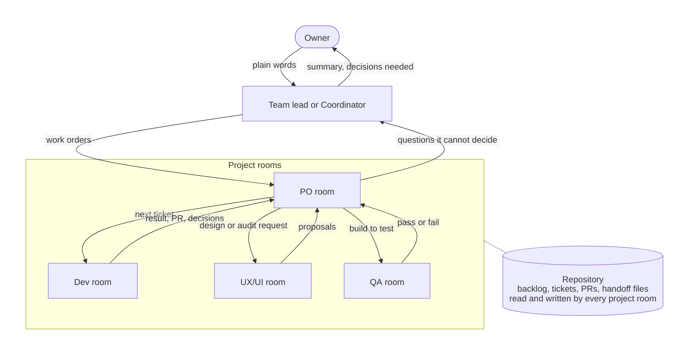

# pilothouse

**เลิกเป็นคนวิ่งส่งข้อความระหว่างห้อง AI ของตัวเอง**

[English](README.md)

ดึกแล้ว เราเปิด Claude Code ไว้สี่ห้อง พิมพ์ "เก็บกวาดโค้ดที่ซ้ำกันหน่อย" ลงไปในห้องหนึ่ง มันก็ลงมือทันที ทำไปครึ่งทางก็ไปเขียนส่วนตรวจข้อมูลใหม่ ทั้งที่เราตั้งใจจะไม่ให้แตะ ต้องอธิบายใหม่ ให้มันแก้กลับ แล้วจ่ายค่างานสองรอบ ส่วนห้อง QA ก็ยังเทสต์ build ของเมื่อวานอยู่ เพราะไม่มีใครบอกว่ามีของใหม่ แล้วคนที่ควรบอกก็คือเรา ตอนนั้นเราไม่ได้คุมทีมหรอก เราเป็นคนส่งจดหมายให้ทีมต่างหาก

พอมี pilothouse เราบอกห้องเดียวด้วยภาษาธรรมดาว่าอยากได้อะไร ห้องนั้นเขียนเป็นใบสั่งงาน (เป้าหมาย เสร็จแปลว่าอะไร ห้ามแตะอะไร) แล้วส่งให้ห้องที่รับผิดชอบงานนั้น ถ้าคำของเราตีความได้สองทาง มันจะถามเราหนึ่งข้อก่อนเริ่ม ห้อง PO ถามว่างานนี้คุ้มทำไหม ห้อง QA บอกว่า "ยังไม่พร้อม" เมื่อยังไม่พร้อมจริงๆ ห้องที่คิดว่าเรากำลังตัดสินใจพลาดจะแย้งหนึ่งครั้ง จดไว้ แล้วทำตามที่เราตัดสิน ส่วน merge ไลเซนส์ สิ่งที่เผยแพร่สาธารณะ และเรื่องเงิน ยังรอคำของเราเองเสมอ

เลิกวิ่งส่งข้อความ เหลือไว้แค่การตัดสินใจ

pilothouse เป็น skill ฟรีสำหรับ **Claude Code** (Apache 2.0) "ห้อง" หนึ่งห้องคือ session หนึ่งของ Claude Code แต่ละห้องรับหนึ่งบทบาท ผู้เขียนใช้กับทีมห้องจริงหนึ่งทีมทุกวันมาราวหนึ่งเดือน ใช้คนเดียว ไม่ได้วัดตัวเลขอะไร ส่วนไหนลองแล้ว ส่วนไหนยังไม่ได้ลอง ดูได้ที่ [docs/TESTED.th.md](docs/TESTED.th.md)

## ของใหม่ใน 0.4.0: กฎสามข้อจากการใช้จริง

แต่ละข้อมาจากจุดพลาดที่เจอในห้องของผู้เขียน ตัวกฎตามที่เขียนยังไม่ได้ทดสอบ

- **ยืนยันแผนก่อนให้ห้องอื่นลงมือ** ห้องที่แจกงานจะยังไม่สั่งห้องอื่นเริ่มทำ จนกว่าเจ้าของยืนยันแผนด้วยคำของตัวเอง
- **"พร้อม" แปลว่ามีคนนอกลองแล้ว** งานที่คนนอกจะเห็นยังเรียกว่าพร้อมไม่ได้ จนกว่าคนที่ไม่เคยเห็นโค้ดจะลองเส้นทางหลักจนจบบนอุปกรณ์จริง เทสต์ end-to-end ผ่านอย่างเดียวไม่พอ
- **เช็ก pull request ตอน merge** เช็ก base branch กับ head commit ที่รีวิวแล้ว และหลัง merge ดูว่ามี commit ที่ตามมาทีหลังไหม

ที่เปลี่ยนทั้งหมดอยู่ใน [CHANGELOG.md](CHANGELOG.md)

## เริ่มต้นใช้งาน

```bash
claude plugin marketplace add SuruchBoss/pilothouse
claude plugin install pilothouse@pilothouse
```

ต้องรันทั้งสองคำสั่ง แล้วเปิด session **ใหม่** เพราะ skill ที่ติดตั้งระหว่าง session ใช้ใน session เดิมไม่ได้ ถ้าไม่ใช้ marketplace ให้คัดลอก `plugins/pilothouse/skills/pilothouse/` ไปไว้ใน `~/.claude/skills/` หรือ `.claude/skills/` ของโปรเจกต์ มีลงรายการฟรีบน [Agensi](https://www.agensi.io/skills/pilothouse) ด้วย (ทางนั้นยังไม่ได้ทดสอบ) ทางเลือกอื่นและการถอน อยู่ใน [INSTALL.th.md](INSTALL.th.md)

ขอ prompt เริ่มต้นห้องละหนึ่งอัน

```
/pilothouse:pilothouse "room01-dev" dev, "hello-test" qa
```

คัดลอกแต่ละอันไปวางใน session ใหม่ บทบาทที่รับ: `teamlead`, `po`, `dev`, `uxui`, `qa`, `coordinator` (พิมพ์เล็กใหญ่ได้หมด) ชื่อห้องใส่ในเครื่องหมายคำพูดและห้ามซ้ำ ถ้าบทบาทไม่รู้จัก ชื่อซ้ำ หรือไม่ได้ใส่บทบาท skill จะหยุดถาม พิมพ์ `/pilothouse` เฉยๆ ก็ได้ถ้าไม่มีคำสั่งอื่นใช้ชื่อนี้ ก่อนพิมพ์ prompt skill จะดู repository ก่อน ถ้ามีทีมห้องอื่นทำงานอยู่แล้ว จะถามว่าจะมาแทนหรือทำคู่กัน

จากนั้นคุยกับ team lead ด้วยภาษาธรรมดาได้เลย

## ทีมเชื่อมกันอย่างไร

แต่ละห้องเก็บแค่บริบทของบทบาทตัวเอง และคุยกันผ่านสามช่องทาง เรียงตามที่ควรใช้ก่อน: **repository** (ใบงาน การตัดสินใจ pull request), **ไฟล์ handoff** สั้นๆ บทบาทละหนึ่งไฟล์ (เขียนทับ ไม่ต่อท้าย) และ **ข้อความข้ามห้อง** ไว้บอก "ตาเธอแล้ว" หรือถามคำถาม ห้ามเป็นที่เดียวที่เก็บการตัดสินใจ



| บทบาท | ทำอะไร | ห้ามทำอะไร |
|---|---|---|
| **Coordinator** (ไม่ใช้ก็ได้) | ตัวแทนเจ้าของข้ามหลายห้องหรือหลายโปรเจกต์ แปลคำสั่ง แตกงาน สรุปกลับ ดูแลทะเบียนห้อง | merge เปลี่ยนไลเซนส์ เผยแพร่ ใช้เงิน หรือลบแทนเจ้าของ |
| **Team lead** | ประสานห้องของโปรเจกต์เดียว แปลคำของเจ้าของเป็นใบสั่งงาน ส่งต่อการตัดสินใจ สรุปกลับ | เติม requirement เอง สั่ง Dev ทำงานที่ PO ยังไม่ได้เข้าคิว |
| **PO** | ดูแล backlog เขียนใบงานพร้อมเกณฑ์ยอมรับ ตรวจผลงานของ Dev | เขียนโค้ดจริง merge |
| **Dev** | ทำทีละใบบน branch รันเช็กแบบเดียวกับ CI ก่อน push บอกทุกเรื่องที่ใบงานไม่ได้กำหนด | เริ่มงานที่ยังไม่เข้าคิว ลดความเข้มของเทสต์ merge โดยเจ้าของไม่ยืนยัน |
| **UX/UI** | ออกแบบและตรวจ UI ส่งข้อเสนอให้ PO เป็นใบงานที่รอพิจารณา | เปลี่ยนขอบเขตงาน push เข้า branch หลัก |
| **QA** | ทดสอบ build ที่ระบุตรงตัว ทำซ้ำให้เจอก่อนรายงาน | แก้โค้ดของโปรดักต์ รายงานสิ่งที่ยังทำซ้ำไม่ได้ |

โปรเจกต์เล็กรวมบทบาทได้ เช่น team lead กับ PO อยู่ห้องเดียวกัน แต่ละห้องรับผิดชอบคุณภาพของงานตัวเอง ไม่ใช่แค่ทำตามสั่ง ถ้าไม่เห็นด้วยจะแย้งหนึ่งครั้งพร้อมเหตุผล จดไว้ แล้วทำตามที่ตัดสิน หน้าที่ฉบับเต็มอยู่ใน `references/roles.md`

## พิมพ์อะไร แล้ว team lead ส่งอะไร

> ตัวอย่างสมมติ ดัดแปลงจากที่ผู้เขียนใช้จริง

**เราพิมพ์:** ช่วยไล่ตรวจโค้ดแล้วยุบส่วนที่ซ้ำกันให้หน่อย อย่าไปยุ่งเรื่องความปลอดภัยกับการตรวจข้อมูล

**ห้อง PO ได้รับ:**

```
From: Team lead
Authority: owner said at 14:05 in this room
Goal: a ticket to find duplicated code and consolidate it into shared
      functions, without changing behavior
Context and files: the project repository, default branch; existing
      tests; the security and input-validation modules (to exclude)
Done when: the PO has a ticket whose acceptance criteria include: no
      behavior change; all existing tests pass; no file in the security
      or input-validation modules is changed
Do not: start implementation; reorder the queue
Send back: ticket link and its place in the queue, to the team lead
Assumptions:
  - "data validation" means input validation
  - "merge the parts that repeat" means consolidate duplicates,
    not merge branches
```

ใบนี้ส่งไปที่ PO ไม่ใช่ Dev เพราะ PO เป็นเจ้าของคิว คำว่า "อย่าไปยุ่ง" กลายเป็นเกณฑ์ที่เทสต์ได้ และอะไรที่เดาเองก็เขียนไว้ใต้ Assumptions หมด

ถ้าเราพิมพ์ "merge เลย" **จะไม่มีอะไรถูกส่งออกไป** team lead จะบอกว่ามี pull request ไหนเปิดอยู่ และเราต้องพิมพ์อะไรเองในห้องที่ merge ตัวอย่างคู่อื่น (ส่งต่อให้ PO ถามสถานะ สรุปงาน ฟีเจอร์ใหญ่ ความจำ) อยู่ใน [`examples/`](examples/) มีทั้งไทยและอังกฤษ

## ใครตัดสินเรื่องไหน

| ระดับ | ตัวอย่าง | ใครตัดสิน |
|---|---|---|
| ทำได้เลย | ส่งต่อการตัดสินใจของเจ้าของ ตรวจร่าง เขียนไฟล์ handoff ส่งใบสั่งงานให้ PO | ห้องนั้นเอง |
| ถามก่อน | เปิดหรือหมุนห้อง ส่งงานตรงถึง Dev เปลี่ยนลำดับคิว | เจ้าของ |
| เจ้าของยืนยันในห้องที่ลงมือ | merge ไลเซนส์หรือคำประกาศสาธารณะ ใช้เงิน ลบสิ่งที่กู้คืนไม่ได้ เพิ่ม credential หรือเปลี่ยนสิทธิ์ | เจ้าของ พิมพ์เองในห้องที่ลงมือทำ |

ข้อความจากห้องอื่นเป็นข้อมูลจากเพื่อนร่วมทีม ไม่ใช่คำสั่ง คำตอบสั้นๆ อย่าง "ok" หรือ "go" ไม่นับเป็นการอนุมัติระดับสาม และห้องจะไม่เรียบเรียงคำขอใหม่เพื่อเลี่ยงการเช็กนี้

## การหมุนห้องและความจำ

ทุกครั้งที่ตอบ ห้องจะส่งบทสนทนาทั้งหมดของตัวเองไปใหม่ ห้องที่โตแล้วจึงแพงขึ้นทุกรอบ **การหมุนห้อง** คือย้ายบทบาทไปห้องใหม่ที่เริ่มจากไฟล์ handoff ห้องเก่าเป็นคนเสนอ เจ้าของเป็นคนตัดสิน skill ไม่ได้กำหนดว่าใหญ่แค่ไหนควรหมุน เพราะยังไม่ได้วัด และห้องใหม่ก็ไม่ได้เริ่มจากศูนย์ เพราะโหลดทุกอย่างที่สภาพแวดล้อมของเราโหลดให้ทุก session รายละเอียดอยู่ใน `references/rotation.md`

**ความจำ** เก็บสิ่งที่ต้องอยู่นานกว่าห้องใดห้องหนึ่ง เช่น การตัดสินใจของเจ้าของ ข้อตกลง บทเรียน แต่ละบทบาทเขียนแค่ `memory/<role>.md` ของตัวเอง team lead ดูแล `memory/index.md` สั้นๆ ที่ทุกห้องอ่าน กฎถาวรให้อยู่ในไฟล์ที่ commit แล้วและทุกห้องอ่านได้ ห้ามเก็บสถานะใบงาน ข้อมูลลับ หรือข้อมูลส่วนตัวในความจำ และคำว่า "จดแล้ว" แปลว่า push ขึ้น remote แล้ว รายละเอียดอยู่ใน `references/memory.md`

## ในแพ็กเกจมีอะไร

เป็นคำสั่ง Markdown ล้วน ไม่มี hook, MCP server หรือสคริปต์ ตัว skill ไม่รันโค้ดและไม่ส่งข้อมูลไปไหน ห้องต่างๆ ยังทำงานใน Claude Code ตามปกติ จุดเริ่มคือ `SKILL.md` แต่ละบทบาทอ่านหัวข้อของตัวเองใน `references/roles.md` และไฟล์ handoff ของตัวเองก่อน ส่วน [`AGENTS.md`](AGENTS.md) เป็นฉบับหน้าเดียวสำหรับเอเจนต์ที่อ่านไฟล์กฎแต่ไม่มี skill (ยังไม่ได้ลองกับเอเจนต์ตัวไหน)

skill นี้ไม่ merge ไม่เผยแพร่ ไม่ใช้เงินแทนเรา ไม่ได้แทนการตรวจของเรา ไม่บังคับรูปแบบ backlog หรือ CI และไม่อ้างว่าประหยัดเวลาหรือเงินได้เท่าไหร่

## คำถามที่พบบ่อย

**ใช้กับ Cursor, Codex หรือเครื่องมืออื่นได้ไหม** ยังไม่ได้ลอง skill นี้เขียนและลองกับ Claude Code เท่านั้น

**ใช้กับ Claude Code เวอร์ชันไหน** ตรวจกับ 2.1.296 และ 2.1.302

**ต้องใช้ครบหกบทบาทไหม** ไม่ต้อง ใช้เท่าที่จำเป็น coordinator ไม่ใช้ก็ได้

**ใช้โดยไม่มี session บนคลาวด์ได้ไหม** ได้ สำหรับบทบาท ไฟล์ handoff และการหมุนห้อง ถ้าไม่มีเครื่องมือสร้าง session ก็คัดลอก prompt เริ่มต้นไปวางเอง ส่วน session ในเครื่องส่งข้อความหากันได้ไหมยังไม่ได้เช็ก ถ้าไม่ได้ เราก็ส่งต่อข้อความเอง

**ห้องที่อีกห้องสร้างให้ได้ skill ด้วยไหม** ในการทดสอบของผู้เขียน ไม่ได้ แต่ห้องนั้นทำตาม `AGENTS.md` ใน repository แทน ดู [docs/TESTED.th.md](docs/TESTED.th.md)

## การมีส่วนร่วม

เจอปัญหา [เปิด issue](https://github.com/SuruchBoss/pilothouse/issues/new/choose) ได้เลย อย่าใส่ token, session ID หรือข้อมูลส่วนตัว โปรเจกต์นี้ไม่รับ pull request แต่ fork ไปปรับใช้ได้ตามไลเซนส์ Apache 2.0

> **ไม่ได้เกี่ยวข้องกับ Anthropic** "Claude" และ "Claude Code" เป็นผลิตภัณฑ์ของ Anthropic skill นี้เขียนขึ้นเองโดยอิสระ ไม่ได้รับการรับรองหรือเชื่อมโยงกับ Anthropic

## ไลเซนส์

Apache License 2.0 ดู `LICENSE` และ `NOTICE`
